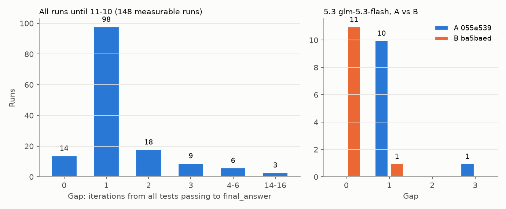
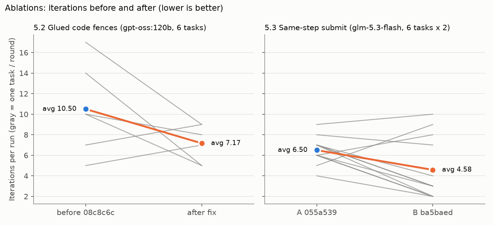
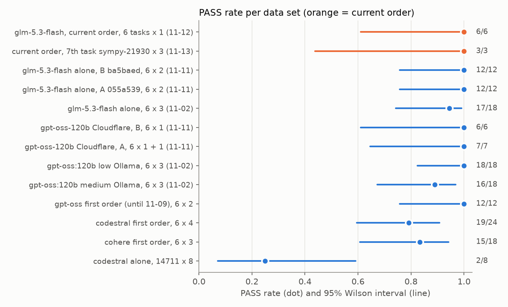
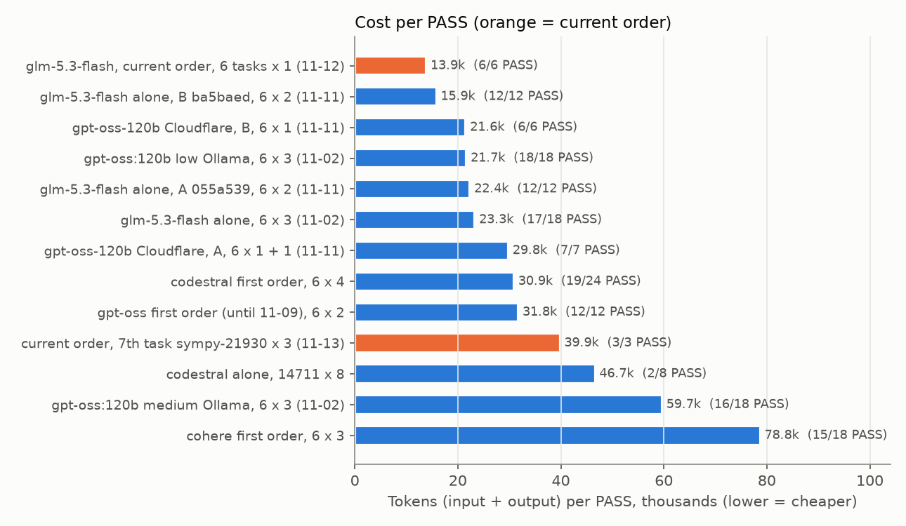

# Agent_SmithにおけるSWE-Benchのモデルベンチマークレポート

[English version](BENCHMARK_REPORT.md)

## 📖*目次*
0. [はじめに](#0-はじめに)
1. [セットアップ](#1-セットアップ)
2. [結果表](#2-結果表)
3. [プロバイダーの信頼性](#3-プロバイダーの信頼性)
4. [中間指標](#4-中間指標以下のうち少なくとも2つ)
5. [アブレーション研究](#5-アブレーション研究)
6. [結論](#6-結論)
7. [本番の設定での確認（全6問）](#7-本番の設定での確認全6問)
8. [統計とコスト](#8-統計とコスト)
9. [再現と限界](#9-再現と限界)
10. [MBPP について](#10-mbpp-について)
11. [データの置き場所](#11-データの置き場所)

## 0. **はじめに**
- **比べたもの**:
- 課題の要件では、SWE-benchを3問以上・5モデル以上・2社以上にまたがって比較することが求められています。
- はじめに比較する問題は、課題PDFで最初に試す単純な問題として挙げている`sympy__sympy-14711`、`sympy__sympy-13480`、`pydata__xarray-4629`の3問を選択しました。
- モデル、プロバイダは6社・11モデル・16設定で比較しました。同じモデルの推論 ON／OFF は、別の設定として数えています。
- 1つの設定につき1モデルだけで回しました(他のモデル、プロバイダへのバックオフ、フォールバックなし)。
- 時間やトークンの制限は実際の制限と同じです。
- そのあと、上位のモデル・アブレーション・本番の並びは、試験の候補の6問（`EXAM_POOL`）すべてで、それぞれ複数回回しました。

- **3問とも PASS したのは7設定**です。そのうち以下の4つは自分から`final_answer`で提出して通しました。
    - Mistral codestral
    - NVIDIA glm-5.3-flash
    - Ollama gpt-oss:120b(推論 low)
    - Cohere command-a
- 残りの3つは反復の上限(30回)で止まった時に、それまでの作業から回収したパッチ（`get_patch()`）で、それぞれ1問（14711）を通しています。

- **アブレーション**（#5）: パラメータ1つと、エージェントの変更2つを、同じモデル・同じ問題で比べました。
  - 推論を強くしても、点は上がりませんでした（#5.1）。出力は約5倍になり（18組中17組、p≈0.0001）、gpt-oss:120b は出力の上限（10,000）に当たりました。
  - 「くっついたコードの囲み」を正しく読むようにすると（#5.2、ツール）、6問で構文エラーが26回から1回に減りました。
  - テストが通った手でそのまま提出するようにすると（#5.3、プロンプト＋ツール）、「テストが初めて全部通ってから `final_answer` まで」の差が 1.18 から 0.08 に（10組中10組、p=0.002）、glm-5.3-flash の反復が 6.50 から 4.58 に減りました。PASS は1つも落ちていません（24/24）。

- **試験の外の7問目**（#1.3・#4）: `sympy__sympy-21930` は落ちるテストが6件あるので、途中の前進が見えます。今の並びで 3/3 でした。どの回も、最初のテストで6件のうち5件を直し、問題文に書かれていない最後の1か所を見つけるまでに、さらに1〜6手かかりました。
- **本番の並び（11-12 に変更）**
    **NVIDIA glm-5.3-flash を1番手、これまでと同じ gpt-oss-120b を Cloudflare で2番手**にします。
  - 11-09 までは、Ollama gpt-oss:120b（推論 low）が1番手でした。試験の候補の6問 × 3周を1モデルだけで 18/18、14711 は 9/9 でした。
  - 11-09 に Ollama Cloud の無料プランが従量課金に変わり、gpt-oss:120b と nemotron-3-ultra はクレジットが要るようになりました。課題は無料枠だけを認めているので、Ollama を両方の並び（SWE・MBPP）から外しました。Ollama の計測の結果は、データとしてこのレポートに残しています。
  - glm-5.3-flash: 6問 × 3周で 17/18（落ちた1回は NVIDIA の通信エラー）、11-11 のアブレーションで 24/24、新しい本番の並びで 6/6 でした（#7）。
  - Cloudflare の gpt-oss-120b: 11-11 に 13/13 でした。無料の1日の枠で SWE を約13回しか回せないので、2番手にしています。

- **使わないもの**:
  - Ollama Cloud。無料ではなくなりました（11-09 から従量課金）。
  - Cohere の command-a-plus と command-a-reasoning（推論 ON）。毎回 HTTP 422 でした。
  - Gemini 3.5-flash。1日の枠が小さすぎました。
  - Groq。1分あたり 8,000 トークンの枠が、SWE の1回の入力より小さいためです。Groq の gpt-oss-120b は、2回試して2回とも最初の呼び出しで本文が空でした。

## 1. **セットアップ**
比較対象としたモデル／プロバイダー、使用したタスク、およびそれらのタスクが選ばれた理由について。

### 1.1 一回の測り方

各設定、タスクについて下記の3ステップで回しました。

1. `moulinette_eval dump swebench --task-id <id>` で `task.json` を書き出す
2. `moulinette_eval run-agent 900 "uv run python -m agent_swebench --task-file … --output … --providers_file_path <その設定だけの providers ファイル>"`
3. `moulinette_eval validate swebench task.json solution.json`（パッチを当ててテストを回し、上限も確かめる）

- 1回に1モデルだけ・フォールバックはなし。どの結果もそのモデル1つのものです。  
- 本番の設定(フォールバックあり)は、別で #7 で測りました。  
- 制限は本番と同じ30反復、入力 300,000、出力 10,000、900秒。全てタスク全体の合計。  
- 全部の設定でプロンプト・ツール・ループは同じです。変えたのは、モデル名とリクエストの設定(`model_params`)だけです。  
- 計測の日の間にエージェントを直したので、データのフォルダによってコードが違います。1つの比べの中で変えたのは1つだけです。フォルダごとのコードは #9 に書きました。

### 1.2 比べたモデルとプロバイダ(6社・11モデル・16設定)

**選び方**:

- OpenRouter, Groq, Mistral, NVIDIA, Google AI Studio, Cohere, Ollama, Kilo, Cloudflare, LLM7, Z AI の11社の無料モデルから選定をはじめ、203モデルありました。  
- この時点で使用できるモデル全てで計測してしまうと無料枠が尽きてしまうため、使えるモデルを絞りました。  
- まず無料モデルの中で、一覧で出てきていたけど実際に使えるものは93件でした。  
- さらにそこから計測するモデルを以下の基準で45件まで絞りました。
  - 応答に20秒以上かかるモデル(Z AI / gemini gemma-4-26b(26秒)、nemotron-bolt(57秒)など)  
  - 古い、または小さいモデル(ministral 3b/8b、allam-2-7b, tiny-ayaなど)  
- その45モデルではじめにMBPPのタスクを簡単なもの10問 × 2周回し、正答率が7 / 10以上の32モデルに絞りました。  
- さらに正答率の低い10問 × 2周の合計1モデル40問を回し、結果として難しい問題では2~7.2 / 10問と一応の差が出ました。同じ問題を複数回回答しての比較ではないため、目安としてこの値を使用しています。  

|順|プロバイダ|モデル|難しい10問|易しい10問|無応答/入力上限(難しい10問・20回中)|平均秒(難しい10問)|
|---|---|---|---|---|---|---|
|1|groq|qwen3.8-27b|**7.2**|10.0|2/3|12.5|
|2|kilo|nemotron-3-ultra-550b|**7.0**|9.0|0/3|20.4|
|3|gemini|3.1-flash-lite|6.7|8.8|5/2|7.6 |
|4|gemini|3.5-flash-lite|6.5|10.0|3/5|8.9|
|4|ollama|gpt-oss:120b|6.5|9.0|0/2|4.0|
|4|cloudflare|gpt-oss-120b|6.5|8.5|0/4|16.2|
|7|ollama|nemotron-3-ultra|6.3|9.0|1/3|28.1|
|8|nvidia| minimax-m3.1-flash|6.2|10.0| 4/2|**73.2**|
|9|cohere|command-a-plus|5.5|7.4|0/4|9.4|
|9|kilo|laguna-s-2.1|5.5|8.0|0/8|22.2|
|9|kilo|dots-3-note-preview|5.5|8.5|0/5|13.4|
|9|mistral|ministral-14b|5.5|9.0|0/10|10.8|
|9|ollama|gemma4:31b|5.5|10.0|0/3|3.8|
|9|ollama|nemotron-3-super|5.5|8.0|0/2|8.5|
|15|groq|gpt-oss-120b|5.3|7.9|5/3|3.2|
|16|cohere|command-a-03-2025|5.0|9.5|2/6|35.4|
|16|nvidia|nemotron-3-ultra-550b|5.0|8.5|0/4|19.1|
|16|nvidia|nemotron-3.5-lightning|5.0|7.5|0/8|7.6|
|-|mistral|**codestral**|**4.0**|7.0|0/8|4.5|

- Geminiの3.5-flash(8.0)と3-flash-preview(6.4)は、20回中9〜10回が枠切れ。11-01に日を改めて難しい10問を先に回しても半分が返らないため1日の枠が小さすぎて主力にも全問計測にも使用できなかった。
- 11-01 の Cloudflare(一日の枠が小さいプロバイダ)の結果:
  - gpt-oss-120b は 6.5、llama-3.3-70b は 3.0。
  - llama-4-scout は set10 で 2.5／5.7 だったので難しい問題には進まず。
  - mistral-small・qwen2.5-coder・gpt-oss-20b は、40回すべて無応答(Cloudflare では使えない)。
- 外したもの:
  - xing4.0・beam・3.7-flash(無応答ばかり)
  - minimax(73秒でMBPP120秒の制限に近い)
  - 4.0未満のモデル(north-mini-code・nano-omni・laguna-xs・gpt-oss-20b・mistral-code・nemotron-3-nano)
  

- この時点でMBPPの計測を上記のモデルで、難しい問題が5.0以上のものから、各プロバイダ1~2モデルに絞り本番のMBPPに近づけるため、1モデルごとではなくプロバイダ、モデルをproviders.jsonに並べ評価対象の全257問を1周回しました。  
- 結果としては 224 / 257で、計測を始める前に出来上がったコードで試しに全問1周回したときのスコア(233 / 257)を下回りました。  
- これは、上記の計測時に難しい10問で7.2のスコアだったgroqのqwen3.8-27bが全体の半分を解いたタイミングで枠が切れ、2番手に置いたkiloのnemotron-ultraがもう半分を解いていたためでした。  
- テスト時は上記計測で4.0のmistral codestralを使用していたので、単純に選別した10問の差ではモデルの差は測れないという結論に至りました。  
- 計測の中で、落としている問題のほとんどは入力トークンの上限でしたが、システムプロンプトや毎回送る履歴などを切り詰めて1往復分の余裕をもたせても、結果として入力上限に引っかかる頻度は減っても今度は出力上限に引っかかったり結果としてスコアの改善には繋がらず有意な差は得られないと感じたため今回は見送りました。  
- ランダム10問では差が測りづらく、全問計測が一番スコアを測りやすいとはいえそれも1周ではばらつきがあり、無料枠を使用しているので何度も測れるわけではなく、また一回の計測に時間もかかる(全問約40分、1000リクエスト前後)ので1つずつ変更をしその度に計測し直すのは現実的ではない、さらに落としている問題の中にはLLMに与えられているテストと問題文では答えを推測するのが難しい問題があり絶対にPASSできる実装にするのは無理だと判断し、MBPPの並びはトークンにも余裕があり以前の計測で上位だったmistral codestralを採用し、2番手にgroqのqwenを置くことで、もしcodestralが回答できなくても正答率の(恐らく)高いモデルにフォールバックできるように変えました。（11-02 時点の並びです。そのあと Mistral の無料のキーが1分2リクエストになったので、11-13 に MBPP の並びを変えました。#10）  

- SWEでは入出力の上限が大きい分推論の多いモデルを使用してもリミットにかかることが減り精度が上がると思い、推論 ON／OFF を同じモデルで並べました。  
- 推論ONの設定は、先にエージェントと同じ形のリクエスト(`stop=["<end_code>"]`・`max_tokens=1200`)で1回ずつ確かめ、どちらも本文にコードが返ってくるもののみを採用しました。
- 最終的にSWE-Benchの計測をしたのが下記の16設定です。

| プロバイダ（無料枠） | モデル | リクエストの設定 |
|---|---|---|
| Mistral | `codestral-latest` | なし |
| Cohere | `command-a-03-2025` | なし |
| Cohere | `command-a-plus-05-2026` | なし |
| Cohere | `command-a-reasoning-08-2025` | `reasoning_effort: none`／既定（ON） |
| NVIDIA NIM | `nvidia/nemotron-3-ultra-550b-a55b` | `enable_thinking: false`／`true` |
| NVIDIA NIM | `z-ai/glm-5.3-flash` | なし（推論する） |
| Ollama Cloud | `gpt-oss:120b` | `reasoning_effort: low`／`medium` |
| Ollama Cloud | `nemotron-3-ultra` | `reasoning_effort: none`／`medium` |
| Kilo Code（OpenRouter 互換） | `nvidia/nemotron-3-ultra-550b-a55b:free` | `reasoning.enabled: false`／`true` |
| Google AI Studio | `gemini-3.1-flash-lite` | `reasoning_effort: medium` |
| Google AI Studio | `gemini-3.5-flash` | なし（推論する） |

|外したもの|理由|
|---|---|
|NVIDIA `minimax-m3.1-flash`| 1回の応答に 81秒。900秒の中で約10回しか呼べない |
|NVIDIA `deepseek-v4.1-flash`| 1回の応答に 100秒 |
|Mistral `mistral-large-4`| `content` が文字列ではなくリストで返る。エージェントは空の応答として扱う |
|Mistral `magistral-medium`| 確かめたときに 429 |
|Ollama `gpt-oss:120b` 推論 high| `finish_reason=tool_calls` で本文が空（自分の形式のツール呼び出しを返す） |
|Kilo `laguna-s-2.1:free`| 計測の日に Kilo の一覧から消えていた（404）。無料モデルは予告なく消える |
|Groq(全モデル)| 1分あたり 8,000 トークンがアカウント単位。SWE の1回は 11,000〜130,000 トークンの入力なので、900秒に収まらない |
|Cloudflare| 1日の枠(10,000 neurons)が、MBPP の計測でも約40分で尽きた。**あとで SWE で測り（11-11、#5.3）、今は本番の2番手** |

**最初の選定のあとの変化（11-09〜11-12）**:

- Ollama Cloud の無料プランが、2026-11-09 に従量課金に変わりました。gpt-oss:120b・gpt-oss:20b・nemotron-3-super・nemotron-3-ultra・gemma4:31b はクレジットが要ります。Ollama はもう使いません。このレポートの Ollama の行は、その日より前に測ったものです。
- 同じ gpt-oss-120b を、ほかの無料のプロバイダで探しました。Cloudflare Workers AI（`@cf/openai/gpt-oss-120b`）と Groq（`openai/gpt-oss-120b`）は無料で出しています。Kilo は有料のモデルだけで、NVIDIA は gpt-oss-20b だけです。
  - Cloudflare は SWE で動きました。11-11 に 13/13 です（#5.3）。
  - Groq は、2回試して2回とも最初の呼び出しで本文が空で、0ステップで止まりました（`LLM_UNAVAILABLE`）。
- **同じモデルでも、プロバイダが違うと結果が変わります。** gpt-oss の出力の形式を OpenAI 互換の応答へ変換するやり方、`reasoning_effort` や止める文字列の扱い、量子化、枠が、社ごとに違います。MBPP の選定では、同じ gpt-oss-120b が難しい10問で 6.5（Ollama）・6.5（Cloudflare）・5.3（Groq）、応答が無かった回は20回中 0・0・5回でした。そのため、Ollama の数字を Cloudflare に使い回さず、測り直しました。

### 1.3 タスク

問題は2組を使い、11-13 に7問目を1つ足しました。

**16設定すべてに使った3問**（#2〜#5.1）: `sympy__sympy-14711`・`sympy__sympy-13480`・`pydata__xarray-4629`。理由は次のとおりです。

- 課題PDFで最初に試す単純な問題として挙げている`sympy__sympy-14711`、`sympy__sympy-13480`、`pydata__xarray-4629`の3問のため。
- 3問とも moulinette の試験の候補(`EXAM_POOL` の6問)に入っていたため。
- 14711 は、モデルの差がいちばん出た問題で、30反復まで使ったモデルが多くありました。

**上位のモデル・アブレーション #5.2〜#5.3・本番の確認 #7 に使った6問**: `EXAM_POOL` の6問すべてです。試験はこの中から3問を選ぶので、エージェントが採点される問題そのものです。

| 問題 | テストの道具 | 元のコードで落ちるテスト（基準） | 使ったところ |
|---|---|---|---|
| django__django-11066 | `tests/runtests.py` | 1件（`test_existing_content_type_rename_other_database`） | 6問 |
| pydata__xarray-4629 | pytest | 1件（`test_merge_attrs_override_copy`） | 3問・6問 |
| scikit-learn__scikit-learn-13439 | pytest | 1件（`test_make_pipeline_memory`） | 6問 |
| sympy__sympy-13480 | `bin/test` | 1件（`test_coth`） | 3問・6問 |
| sympy__sympy-14711 | `bin/test` | 1件（`test_Vector`） | 3問・6問 |
| sympy__sympy-18189 | `bin/test` | 1件（`test_diophantine`） | 6問 |

- 基準は LLM を使わずに測りました。問題の採点のスクリプト（`eval_script`）を、元のコードのまま、その問題の Docker イメージで回しました（`benchmark/swebench/baseline_original_code/<問題>.log`）。
- どの問題でも、落ちるテストはデータセットの `FAIL_TO_PASS` にあるものと同じです。
- 6問とも、落ちるテストはちょうど1件です。これは #4 の指標の1つに効きます。

**試験の外の7問目（11-13 に足した）**: `sympy__sympy-21930`（SWE-bench Verified、「15分〜1時間」、1ファイルのパッチ、2021年）。

- 落ちるテストが2件以上の候補（`django__django-16667`・`pydata__xarray-7393`・`sympy__sympy-21930`・`scikit-learn__scikit-learn-26194`）から、一番多い6件（`test_create`・`test_commutation`・`test_create_f`・`test_NO`・`test_Tensors`・`test_issue_19661`。`FAIL_TO_PASS` と同じ）のものを選びました。6件あれば、#4 の「途中の前進」の指標が動きます。
- 試験の3問と同じリポジトリなので、`run_tests()` は要約の行を同じように読めます。

| 問題 | テストの道具 | 元のコードで落ちるテスト（基準） | 使ったところ |
|---|---|---|---|
| sympy__sympy-21930 | `bin/test` | **6件**（`RESULT: FAILED (46 passed, 6 failed, 1 skipped)`） | 7問目（#4・#7） |

- 正解のパッチの3か所を1つずつ当てると、落ちる数は 6 → 5 → 3 → 0 と減り、全部当てると `RESULT: PASSED (52 passed, 1 skipped)` になりました（`benchmark/swebench/task7_sympy21930/baseline/`）。`run_tests()` の判定の行（#5.3）は、作ったときの6問の外の問題でも働きます。

## 2. **結果表**
- 各モデル × タスクの組み合わせについて
    - 合格／不合格
    - 使用した反復回数
    - 入力トークンの総数
    - 出力トークンの総数
    - 実時間
    
| 設定 | タスク | 結果 | 反復 | 入力トークン | 出力トークン | 時間(秒) | 止まった理由 |
|---|---|---|---|---|---|---|---|
| Mistral / codestral-latest | xarray-4629 | [PASS](benchmark/swebench/selection_easy3/mistral_codestral/r1/pydata__xarray-4629/solution.json) | 4 | 11,288 | 244 | 15 | final_answer |
| Mistral / codestral-latest | sympy-13480 | [PASS](benchmark/swebench/selection_easy3/mistral_codestral/r1/sympy__sympy-13480/solution.json) | 3 | 5,331 | 222 | 19 | final_answer |
| Mistral / codestral-latest | sympy-14711 | [PASS](benchmark/swebench/selection_easy3/mistral_codestral/r1/sympy__sympy-14711/solution.json) | 4 | 7,747 | 454 | 18 | final_answer |
| NVIDIA / glm-5.3-flash（推論あり） | xarray-4629 | [PASS](benchmark/swebench/selection_easy3/nvidia_glm53_flash/r1/pydata__xarray-4629/solution.json) | 6 | 18,759 | 592 | 232 | final_answer |
| NVIDIA / glm-5.3-flash（推論あり） | sympy-13480 | [PASS](benchmark/swebench/selection_easy3/nvidia_glm53_flash/r1/sympy__sympy-13480/solution.json) | 5 | 11,710 | 536 | 168 | final_answer |
| NVIDIA / glm-5.3-flash（推論あり） | sympy-14711 | [PASS](benchmark/swebench/selection_easy3/nvidia_glm53_flash/r1/sympy__sympy-14711/solution.json) | 5 | 14,950 | 1,021 | 75 | final_answer |
| Ollama / gpt-oss:120b（推論 low） | xarray-4629 | [PASS](benchmark/swebench/selection_easy3/ollama_gptoss120_low/r1/pydata__xarray-4629/solution.json) | 14 | 50,148 | 1,106 | 26 | final_answer |
| Ollama / gpt-oss:120b（推論 low） | sympy-13480 | [PASS](benchmark/swebench/selection_easy3/ollama_gptoss120_low/r1/sympy__sympy-13480/solution.json) | 6 | 11,567 | 352 | 23 | final_answer |
| Ollama / gpt-oss:120b（推論 low） | sympy-14711 | [PASS](benchmark/swebench/selection_easy3/ollama_gptoss120_low/r1/sympy__sympy-14711/solution.json) | 20 | 65,169 | 3,178 | 39 | final_answer |
| Ollama / gpt-oss:120b（推論 medium） | xarray-4629 | [FAIL](benchmark/swebench/selection_easy3/ollama_gptoss120_medium/r1/pydata__xarray-4629/solution.json) | 17 | 65,782 | 10,000 | 55 | MAX_OUTPUT_TOKENS |
| Ollama / gpt-oss:120b（推論 medium） | sympy-13480 | [PASS](benchmark/swebench/selection_easy3/ollama_gptoss120_medium/r1/sympy__sympy-13480/solution.json) | 9 | 27,311 | 3,371 | 41 | final_answer |
| Ollama / gpt-oss:120b（推論 medium） | sympy-14711 | [PASS](benchmark/swebench/selection_easy3/ollama_gptoss120_medium/r1/sympy__sympy-14711/solution.json) | 13 | 47,192 | 5,982 | 68 | final_answer |
| Cohere / command-a-03-2025 | xarray-4629 | [PASS](benchmark/swebench/selection_easy3/cohere_command_a/r1/pydata__xarray-4629/solution.json) | 6 | 25,934 | 529 | 88 | final_answer |
| Cohere / command-a-03-2025 | sympy-13480 | [PASS](benchmark/swebench/selection_easy3/cohere_command_a/r1/sympy__sympy-13480/solution.json) | 5 | 13,817 | 443 | 56 | final_answer |
| Cohere / command-a-03-2025 | sympy-14711 | [PASS](benchmark/swebench/selection_easy3/cohere_command_a/r1/sympy__sympy-14711/solution.json) | 9 | 27,276 | 1,000 | 168 | final_answer |
| Cohere / command-a-plus-05-2026 | xarray-4629 | [FAIL](benchmark/swebench/selection_easy3/cohere_command_a_plus/r1/pydata__xarray-4629/solution.json) | 0 | 0 | 0 | 4 | LLM_UNAVAILABLE |
| Cohere / command-a-plus-05-2026 | sympy-13480 | [FAIL](benchmark/swebench/selection_easy3/cohere_command_a_plus/r1/sympy__sympy-13480/solution.json) | 0 | 0 | 0 | 7 | LLM_UNAVAILABLE |
| Cohere / command-a-plus-05-2026 | sympy-14711 | [FAIL](benchmark/swebench/selection_easy3/cohere_command_a_plus/r1/sympy__sympy-14711/solution.json) | 0 | 0 | 0 | 10 | LLM_UNAVAILABLE |
| Cohere / command-a-reasoning（推論 none） | xarray-4629 | [PASS](benchmark/swebench/selection_easy3/cohere_reasoning_off/r1/pydata__xarray-4629/solution.json) | 2 | 5,611 | 300 | 9 | LLM_UNAVAILABLE |
| Cohere / command-a-reasoning（推論 none） | sympy-13480 | [PASS](benchmark/swebench/selection_easy3/cohere_reasoning_off/r1/sympy__sympy-13480/solution.json) | 4 | 8,877 | 188 | 27 | final_answer |
| Cohere / command-a-reasoning（推論 none） | sympy-14711 | [FAIL](benchmark/swebench/selection_easy3/cohere_reasoning_off/r1/sympy__sympy-14711/solution.json) | 1 | 1,930 | 64 | 15 | LLM_UNAVAILABLE |
| Cohere / command-a-reasoning（推論 ON） | xarray-4629 | [FAIL](benchmark/swebench/selection_easy3/cohere_reasoning_on/r1/pydata__xarray-4629/solution.json) | 1 | 2,654 | 534 | 15 | LLM_UNAVAILABLE |
| Cohere / command-a-reasoning（推論 ON） | sympy-13480 | [FAIL](benchmark/swebench/selection_easy3/cohere_reasoning_on/r1/sympy__sympy-13480/solution.json) | 0 | 0 | 0 | 6 | LLM_UNAVAILABLE |
| Cohere / command-a-reasoning（推論 ON） | sympy-14711 | [FAIL](benchmark/swebench/selection_easy3/cohere_reasoning_on/r1/sympy__sympy-14711/solution.json) | 1 | 1,930 | 1,199 | 15 | LLM_UNAVAILABLE |
| Kilo / nemotron-3-ultra:free（推論 OFF） | xarray-4629 | [PASS](benchmark/swebench/selection_easy3/kilo_ultra_off/r1/pydata__xarray-4629/solution.json) | 9 | 58,964 | 9,423 | 425 | final_answer |
| Kilo / nemotron-3-ultra:free（推論 OFF） | sympy-13480 | [PASS](benchmark/swebench/selection_easy3/kilo_ultra_off/r1/sympy__sympy-13480/solution.json) | 7 | 19,104 | 572 | 36 | final_answer |
| Kilo / nemotron-3-ultra:free（推論 OFF） | sympy-14711 | [PASS\*](benchmark/swebench/selection_easy3/kilo_ultra_off/r1/sympy__sympy-14711/solution.json) | 30 | 122,730 | 3,245 | 235 | MAX_ITERATIONS |
| Kilo / nemotron-3-ultra:free（推論 ON） | xarray-4629 | [PASS](benchmark/swebench/selection_easy3/kilo_ultra_on/r1/pydata__xarray-4629/solution.json) | 10 | 46,892 | 1,403 | 82 | final_answer |
| Kilo / nemotron-3-ultra:free（推論 ON） | sympy-13480 | [PASS](benchmark/swebench/selection_easy3/kilo_ultra_on/r1/sympy__sympy-13480/solution.json) | 8 | 21,252 | 764 | 92 | final_answer |
| Kilo / nemotron-3-ultra:free（推論 ON） | sympy-14711 | [FAIL](benchmark/swebench/selection_easy3/kilo_ultra_on/r1/sympy__sympy-14711/solution.json) | 27 | 105,197 | 4,097 | 180 | LLM_UNAVAILABLE |
| NVIDIA / nemotron-3-ultra（推論 OFF） | xarray-4629 | [PASS](benchmark/swebench/selection_easy3/nvidia_ultra_off/r1/pydata__xarray-4629/solution.json) | 15 | 65,633 | 1,216 | 99 | final_answer |
| NVIDIA / nemotron-3-ultra（推論 OFF） | sympy-13480 | [PASS](benchmark/swebench/selection_easy3/nvidia_ultra_off/r1/sympy__sympy-13480/solution.json) | 7 | 19,376 | 617 | 42 | final_answer |
| NVIDIA / nemotron-3-ultra（推論 OFF） | sympy-14711 | [FAIL](benchmark/swebench/selection_easy3/nvidia_ultra_off/r1/sympy__sympy-14711/solution.json) | 30 | 131,210 | 2,562 | 132 | MAX_ITERATIONS |
| NVIDIA / nemotron-3-ultra（推論 ON） | xarray-4629 | [PASS](benchmark/swebench/selection_easy3/nvidia_ultra_on/r1/pydata__xarray-4629/solution.json) | 9 | 34,193 | 1,160 | 82 | final_answer |
| NVIDIA / nemotron-3-ultra（推論 ON） | sympy-13480 | [PASS](benchmark/swebench/selection_easy3/nvidia_ultra_on/r1/sympy__sympy-13480/solution.json) | 6 | 13,774 | 475 | 57 | final_answer |
| NVIDIA / nemotron-3-ultra（推論 ON） | sympy-14711 | [PASS\*](benchmark/swebench/selection_easy3/nvidia_ultra_on/r1/sympy__sympy-14711/solution.json) | 30 | 108,468 | 3,991 | 192 | MAX_ITERATIONS |
| Ollama / nemotron-3-ultra（推論 none） | xarray-4629 | [PASS](benchmark/swebench/selection_easy3/ollama_ultra_none/r1/pydata__xarray-4629/solution.json) | 11 | 54,305 | 1,468 | 85 | final_answer |
| Ollama / nemotron-3-ultra（推論 none） | sympy-13480 | [PASS](benchmark/swebench/selection_easy3/ollama_ultra_none/r1/sympy__sympy-13480/solution.json) | 6 | 14,411 | 488 | 39 | final_answer |
| Ollama / nemotron-3-ultra（推論 none） | sympy-14711 | [PASS\*](benchmark/swebench/selection_easy3/ollama_ultra_none/r1/sympy__sympy-14711/solution.json) | 30 | 110,291 | 2,517 | 175 | MAX_ITERATIONS |
| Ollama / nemotron-3-ultra（推論 medium） | xarray-4629 | [PASS](benchmark/swebench/selection_easy3/ollama_ultra_medium/r1/pydata__xarray-4629/solution.json) | 21 | 124,476 | 2,639 | 220 | final_answer |
| Ollama / nemotron-3-ultra（推論 medium） | sympy-13480 | [PASS\*](benchmark/swebench/selection_easy3/ollama_ultra_medium/r1/sympy__sympy-13480/solution.json) | 30 | 106,696 | 3,702 | 278 | MAX_ITERATIONS |
| Ollama / nemotron-3-ultra（推論 medium） | sympy-14711 | [FAIL](benchmark/swebench/selection_easy3/ollama_ultra_medium/r1/sympy__sympy-14711/solution.json) | 30 | 125,707 | 4,726 | 282 | MAX_ITERATIONS |
| Google / gemini-3.1-flash-lite（推論 medium） | xarray-4629 | [PASS](benchmark/swebench/selection_easy3/gemini_31lite_medium/r1/pydata__xarray-4629/solution.json) | 3 | 10,093 | 878 | 36 | final_answer |
| Google / gemini-3.1-flash-lite（推論 medium） | sympy-13480 | [PASS](benchmark/swebench/selection_easy3/gemini_31lite_medium/r1/sympy__sympy-13480/solution.json) | 3 | 9,096 | 670 | 48 | final_answer |
| Google / gemini-3.1-flash-lite（推論 medium） | sympy-14711 | [FAIL](benchmark/swebench/selection_easy3/gemini_31lite_medium/r1/sympy__sympy-14711/solution.json) | 6 | 27,368 | 2,715 | 115 | final_answer |
| Google / gemini-3.5-flash | xarray-4629 | [FAIL](benchmark/swebench/selection_easy3/gemini_35flash/r1/pydata__xarray-4629/solution.json) | 0 | 2,647 | 0 | 42 | LLM_UNAVAILABLE |
| Google / gemini-3.5-flash | sympy-13480 | [FAIL](benchmark/swebench/selection_easy3/gemini_35flash/r1/sympy__sympy-13480/solution.json) | 0 | 0 | 0 | 10 | LLM_UNAVAILABLE |
| Google / gemini-3.5-flash | sympy-14711 | [FAIL](benchmark/swebench/selection_easy3/gemini_35flash/r1/sympy__sympy-14711/solution.json) | 6 | 22,734 | 496 | 30 | LLM_UNAVAILABLE |

PASS\*について:  
  反復の上限で止まり、エージェントが最後に回収したパッチ(`get_patch()`)が採点で通った回。
  `LLM_UNAVAILABLE` で PASS の回(Cohere reasoning none の xarray)も同じで、途中で応答が止まったときの回収パッチが通っています。

**3問の合計**:

| 設定 | 結果 | うち自分で提出 | 平均反復 | 平均入力 | 平均出力 | 平均秒 |
|---|---|---|---|---|---|---|
| Mistral / codestral-latest | **3/3** | 3 | 4 | 8,122 | 307 | **17** |
| NVIDIA / glm-5.3-flash | **3/3** | 3 | 5 | 15,140 | 716 | 158 |
| Ollama / gpt-oss:120b（low） | **3/3** | 3 | 13 | 42,295 | 1,545 | 29 |
| Cohere / command-a-03-2025 | **3/3** | 3 | 7 | 22,342 | 657 | 104 |
| Kilo / nemotron-3-ultra（OFF） | 3/3 | 2 | 15 | 66,933 | 4,413 | 232 |
| NVIDIA / nemotron-3-ultra（ON） | 3/3 | 2 | 15 | 52,145 | 1,875 | 110 |
| Ollama / nemotron-3-ultra（none） | 3/3 | 2 | 16 | 59,669 | 1,491 | 100 |
| NVIDIA / nemotron-3-ultra（OFF） | 2/3 | 2 | 17 | 72,073 | 1,465 | 91 |
| Kilo / nemotron-3-ultra（ON） | 2/3 | 2 | 15 | 57,780 | 2,088 | 118 |
| Ollama / gpt-oss:120b（medium） | 2/3 | 2 | 13 | 46,762 | 6,451 | 55 |
| Ollama / nemotron-3-ultra（medium） | 2/3 | 1 | 27 | 118,960 | 3,689 | 260 |
| Google / gemini-3.1-flash-lite（medium） | 2/3 | 2 | 4 | 15,519 | 1,421 | 66 |
| Cohere / command-a-reasoning（none） | 2/3 | 1 | 2 | 5,473 | 184 | 17 |
| Cohere / command-a-reasoning（ON） | 0/3 | 0 | - | - | - | - |
| Cohere / command-a-plus | 0/3 | 0 | - | - | - | - |
| Google / gemini-3.5-flash | 0/3 | 0 | - | - | - | - |

## 3. **プロバイダーの信頼性**
- 各モデル／プロバイダーについて
    - リクエストあたりの平均応答時間
    - 必要な再試行回数（レート制限、タイムアウト、エラー）
    - ベンチマーク実行中の全体的な可用性 

- 数え方（`solution.json` から）:
  - リクエスト数: `total_requests`。失敗したリクエスト: ステップにならなかったリクエスト（`total_requests` − ステップの数）。成功率: ステップ ÷ リクエスト。
  - リトライ: 各ステップの `retries` の合計。
  - 可用性: プロバイダのせいで終わらなかった回（`error` が `LLM_UNAVAILABLE` でない回）。最後の列です。
  
| 設定 | 結果 | 1リクエストの平均応答時間(秒) | リクエスト数 | リトライ | 失敗したリクエスト | 成功率 | 提供側の失敗で終わらなかった回 |
|---|---|---|---|---|---|---|---|
| Mistral / codestral-latest | 3/3 | **1.4** | 11 | 0 | 0 | 100% | 3/3 |
| NVIDIA / glm-5.3-flash | 3/3 | 27.3 | 16 | 0 | 0 | 100% | 3/3 |
| Ollama / gpt-oss:120b（low） | 3/3 | **1.2** | 40 | 0 | 0 | 100% | 3/3 |
| Ollama / gpt-oss:120b（medium） | 2/3 | 2.3 | 39 | 0 | 0 | 100% | 3/3 |
| Cohere / command-a-03-2025 | 3/3 | 8.7 | 21 | 1 | 1 | 95% | 3/3 |
| Cohere / command-a-plus-05-2026 | 0/3 | - | 3 | 0 | 3 | 0% | 0/3 |
| Cohere / command-a-reasoning（none） | 2/3 | 2.7 | 9 | 0 | 2 | 78% | 1/3 |
| Cohere / command-a-reasoning（ON） | 0/3 | 10.5 | 5 | 0 | 3 | 40% | 0/3 |
| Kilo / nemotron-3-ultra（OFF） | 3/3 | 12.2 | 47 | 1 | 1 | 98% | 3/3 |
| Kilo / nemotron-3-ultra（ON） | 2/3 | 6.4 | 46 | 0 | 1 | 98% | 2/3 |
| NVIDIA / nemotron-3-ultra（OFF） | 2/3 | 4.2 | 52 | 0 | 0 | 100% | 3/3 |
| NVIDIA / nemotron-3-ultra（ON） | 3/3 | 5.6 | 46 | 1 | 1 | 98% | 3/3 |
| Ollama / nemotron-3-ultra（none） | 3/3 | 4.8 | 47 | 0 | 0 | 100% | 3/3 |
| Ollama / nemotron-3-ultra（medium） | 2/3 | 7.3 | 82 | 1 | 1 | 99% | 3/3 |
| Google / gemini-3.1-flash-lite（medium） | 2/3 | 13.5 | 12 | 0 | 0 | 100% | 3/3 |
| Google / gemini-3.5-flash | 0/3 | 3.0 | 12 | 0 | 6 | 50% | 0/3 |

- **Mistral・Ollama は、失敗したリクエストがほぼ0件**（Ollama nemotron-3-ultra の推論 medium の1件だけで、リトライで回復）。応答も、推論 medium を除けば 1.2〜4.8秒と速い。
- **Cohere は、モデルによって大きく違います**。
  - command-a は 95%（1件の失敗は、リトライで回復）でした。
  - plus と reasoning は、422 でほとんど使えませんでした。
  - 10-30 の試しでも、command-a が途中から 422 になる回がありました。
  - 試用キーは月 1,000回までと少なめです。
  - 1回の応答が 8.7秒と遅めです。選定では 93.9秒かかった応答もありました。
- **NVIDIA は、落ちないが遅いことがあります**。
  - glm-5.3-flash は1回 27秒、nemotron-3-ultra は 4〜6秒でした。確かめのとき、推論 ON で1回だけ 503 が出ました。
- **Kilo** は、OpenRouter と同じ形のゲートウェイです。
  - `:free` のモデルは、予告なく一覧から消えます（laguna-s が計測の日に消えた）。
- **Google** は、gemini-3.5-flash の1日の枠が小さすぎます。3問を回し切れませんでした。

**今の本番の並びのプロバイダ（6問）**:

| 設定 | データ | 結果 | 1リクエストの平均応答時間(秒) | リクエスト数 | リトライ | 失敗したリクエスト | 成功率 | 提供側の失敗で終わらなかった回 |
|---|---|---|---|---|---|---|---|---|
| NVIDIA / glm-5.3-flash | #7、6問 × 3周（11-02） | 17/18 | 10.6 | 117 | 3 | 6 | 95% | 17/18 |
| NVIDIA / glm-5.3-flash | #5.3、A と B、6問 × 2周（11-11） | 24/24 | 13.0 | 135 | 2 | 2 | 99% | 24/24 |
| Cloudflare / gpt-oss-120b（low） | #5.3、A と B（11-11） | 13/13 | 5.4 | 90 | 0 | 0 | 100% | 13/13 |
| Groq / gpt-oss-120b（low） | 試し、2回（11-11） | 0/2 | - | 2 | 0 | 2 | 0% | 0/2 |
| 今の本番の並び（glm が1番手） | #7、6問 × 1周（11-12） | 6/6 | 30.7 | 33 | 4 | 4 | 88% | 6/6 |

- **NVIDIA の glm-5.3-flash** は、遅いけれど安定しています。1回の応答は 11-02・11-11 に 10〜13秒でしたが、11-01 は 27秒、11-12 は 31秒でした。無料の窓口の応答時間は、日によって変わります。落とした1回（11-02）は、NVIDIA の通信エラー（`TransportError`）でした。11-12 にも4回のリクエストで同じエラーが出ましたが、どれもリトライで通りました（2回 × 2リトライ）。
- **Cloudflare** は、13回で失敗したリクエストが0、1回 5.4秒でした。ただ、その日の14回目の SWE で HTTP 429 が返りました。無料の1日の枠（10,000 neurons、日本時間 9:00 に戻る）で、SWE は約13回です。試験（3問）には足りますが、いつも1番手にして計測を回すには足りません。
  - Cloudflare の gpt-oss-120b は、ときどきコードの無い応答を返しました（#5.3 の変更の前は7回で13手、後は6回で6手）。その手は何も実行せず、反復だけを使います。glm は24回で1手でした。
- **Groq の gpt-oss-120b** は、最初の呼び出しで本文が空でした（出力 42・70 トークンで、文字が無い）。エージェントは本文が空の応答を空振りとして次のモデルへ移ります。Groq だけの設定だったので、そこで止まりました。


## 4. **中間指標**（以下のうち少なくとも2つ）
- エージェントが、最終パッチに含まれるファイルを初めて読み込んだ／編集したステップ（探索効率）
- テストの失敗数がベースラインと比較して初めて減少したステップ（部分的な進捗）
- 「tests first pass」とfinal_answerの間の反復回数（提出の規律— 0回が理想的）
これらの指標は、**solution.json** ファイルを確認することで手動で測定可能です
自動化は必須ではありません。重要なのは分析そのものであり、ツールではありません。

| 設定 | タスク | 最終パッチのファイルを初めて読んだステップ | 初めて編集したステップ | テストが全部通ってから final_answer までの反復 |
|---|---|---|---|---|
| Mistral / codestral-latest | xarray-4629 | 2 | 3 | 1 |
| Mistral / codestral-latest | sympy-13480 | 2 | 3 | 0 |
| Mistral / codestral-latest | sympy-14711 | 2 | 4 | 0 |
| NVIDIA / glm-5.3-flash | xarray-4629 | 2 | 3 | 1 |
| NVIDIA / glm-5.3-flash | sympy-13480 | 2 | 3 | 1 |
| NVIDIA / glm-5.3-flash | sympy-14711 | 1 | 3 | 1 |
| Ollama / gpt-oss:120b（low） | xarray-4629 | 12 | 13 | - |
| Ollama / gpt-oss:120b（low） | sympy-13480 | - | 3 | 1 |
| Ollama / gpt-oss:120b（low） | sympy-14711 | 3 | 11 | 3 |
| Ollama / gpt-oss:120b（medium） | sympy-13480 | 4 | 5 | 1 |
| Ollama / gpt-oss:120b（medium） | sympy-14711 | 3 | 5 | 1 |
| Cohere / command-a-03-2025 | xarray-4629 | 2 | 3 | 1 |
| Cohere / command-a-03-2025 | sympy-13480 | 2 | 3 | 1 |
| Cohere / command-a-03-2025 | sympy-14711 | 2 | 7 | 2 |
| Kilo / nemotron-3-ultra（OFF） | xarray-4629 | 1 | 2 | 6 |
| Kilo / nemotron-3-ultra（OFF） | sympy-13480 | 1 | 2 | 3 |
| Kilo / nemotron-3-ultra（OFF） | sympy-14711 | 2 | 27 | - |
| Kilo / nemotron-3-ultra（ON） | xarray-4629 | 3 | 5 | 3 |
| Kilo / nemotron-3-ultra（ON） | sympy-13480 | 2 | 3 | 2 |
| NVIDIA / nemotron-3-ultra（OFF） | xarray-4629 | 4 | 11 | 2 |
| NVIDIA / nemotron-3-ultra（OFF） | sympy-13480 | 1 | 2 | 3 |
| NVIDIA / nemotron-3-ultra（ON） | xarray-4629 | 2 | 4 | 3 |
| NVIDIA / nemotron-3-ultra（ON） | sympy-13480 | 2 | 3 | 1 |
| NVIDIA / nemotron-3-ultra（ON） | sympy-14711 | 2 | 22 | - |
| Ollama / nemotron-3-ultra（none） | xarray-4629 | 2 | 4 | 5 |
| Ollama / nemotron-3-ultra（none） | sympy-13480 | 1 | 2 | 2 |
| Ollama / nemotron-3-ultra（none） | sympy-14711 | 2 | 15 | - |
| Ollama / nemotron-3-ultra（medium） | xarray-4629 | 3 | 5 | 14 |
| Ollama / nemotron-3-ultra（medium） | sympy-13480 | 2 | 4 | - |
| Google / gemini-3.1-flash-lite（medium） | xarray-4629 | 1 | 1 | - |
| Google / gemini-3.1-flash-lite（medium） | sympy-13480 | 1 | 1 | - |
| Google / gemini-3.1-flash-lite（medium） | sympy-14711 | 1 | 5 | - |

- パッチを作らなかった回（422 で止まった回など）は省きました。
- `-` の意味:
  - 「読んだ」が `-`: `read_file` を使わずに、`run_command`（`sed -n`・`cat`）や `search_code` で中身を見た回です。
  - 最後の列が `-`: `run_tests()` が全部通ったのを見ないまま終わった回です。テストを回さずに提出した回と、反復の上限で止まった回があります。

**3つ目の指標: テストの失敗が、基準より初めて減った手**:

- 基準: 元のコードで落ちるテストの数（#1.3）。6問とも 1 です。
- 数は、`run_tests()` を呼んだ手の出力から読みます。pytest・sympy の `bin/test`・Django の `runtests.py` の要約の行と、11-11 からは判定の行 `RESULT: …`（#5.3）です。
- 基準が 1 なので、「基準より減る」＝「0 になる」＝「全部通る」です。そのため、この6問では、この指標は「初めて全部通った手」と必ず同じ値になります。11-10 にあった213回で確かめると、213回すべてで同じ手でした。
- **気づき**: この指標で途中の前進が見えるのは、落ちるテストが2件以上の問題だけです。試験の6問では、モデルの差を分けられません。そこで、落ちるテストが6件ある7問目を足しました（#1.3）。

**7問目**（`sympy__sympy-21930`・今の並び・3回・11-13）:

| 回 | 結果 | 最終パッチのファイルを初めて読む／編集する手 | 失敗が基準（6件）より初めて減った手 | テストが初めて全部通った手 | 差 | 反復 |
|---|---|---|---|---|---|---|
| r1 | [PASS](benchmark/swebench/task7_sympy21930/r1/sympy__sympy-21930/solution.json) | 2 ／ 5 | 6（6 → 1） | 7 | 0 | 7 |
| r2 | [PASS](benchmark/swebench/task7_sympy21930/r2/sympy__sympy-21930/solution.json) | 2 ／ 4 | 6（6 → 1） | 10 | 0 | 10 |
| r3 | [PASS](benchmark/swebench/task7_sympy21930/r3/sympy__sympy-21930/solution.json) | 2 ／ 6 | 7（6 → 1） | 13 | 0 | 13 |

- 3回とも、最初の編集で問題文に出てくる `b^\dagger` と、同じ形の `a^\dagger` を直し、最初のテストで落ちる数が6件から1件に減りました。
- 残った1件の `test_Tensors` は、`AntiSymmetricTensor._latex` にも同じ直しが要ります。問題文には書かれていない場所です。見つけるまでに、さらに1・4・6手かかりました。
- **気づき**: この問題では、「初めて減った手」と「全部通った手」が別の手になります。その差は、問題文が名指ししていない部分を探す長さです。試験の6問にはこの段階が無いので、そこでの反復の数は、主に「名指しされた関数をどれだけ早く見つけるか」を測っています。
- 差は3回とも 0 でした（#5.3）。
- r3 では、10手目で glm-5.3-flash が空の応答を返しました。エージェントは2番手（Cloudflare の gpt-oss-120b）に移り、そのモデルが最後の直しを見つけて13手目で通しました。
**探索の効率**:

- 3問とも PASS した上位4設定のうち、gpt-oss:120b（low）を除く3設定は、正しいファイルを1〜2ステップ目で読み、3〜4ステップ目（14711 の Cohere は7）で編集しています。課題文が直す関数を名指ししているので、強いモデルはまっすぐそこへ行きます。
- 差が出たのは 14711 です。nemotron-3-ultra は、どの社でも2ステップ目には正しいファイルを読んでいます。それでも、最初の編集は15・22・27ステップ目でした。読んではいるのに、直す方針を決めきれず、確かめをくり返しています。
- gpt-oss:120b（low）の xarray は、最終パッチのファイル（`merge.py`）を12ステップ目に初めて読んでいます。それまでは `search_code` と `run_command` で、まわりを探していました。

**提出の規律**:

- codestral は、14711・13480 で **0**（テストを回して、通ったらそのまま同じステップで `final_answer(get_patch())`）でした。xarray は 1 です。
- Cohere command-a と glm-5.3-flash は、ほぼ 1 です（結果を読んでから提出）。
- nemotron-3-ultra は、通ってからも 1〜6回、medium では14回も確かめを続けました。
- SWE では、残りが4反復になると「探すのをやめて提出せよ」とエージェントが伝えます（`[BUDGET]`・`iteration_warn_at=4`）。それでも、反復の上限に当たった回がありました。
- gemini-3.1-flash-lite は、3問とも `run_tests()` が全部通るのを見ないまま提出しました（列が `-`）。14711 は、それで隠れたテストに落ちています。

**全部の回で見た差**（213回のうち差を数えられる148回、11-10）:

| 差（テストが全部通ってから `final_answer` までの反復） | 0 | 1 | 2 | 3 | 4〜6 | 14・16 |
|---|---|---|---|---|---|---|
| 回数 | 14 | **98** | 18 | 9 | 6 | 3 |



*図1. 左: 11-10 までの、差を数えられる148回の差。右: #5.3 の変更の前（A）と後（B）の glm-5.3-flash の差。*

- **気づき**: 66% の回で、差がちょうど 1 でした。原因はモデルではなく、こちらの few-shot の例でした。例が「テストを回し、次の手で結果を読んでから提出する」形だったので、モデルがそれをまねていました。テストと同じ手で `final_answer(get_patch())` を書くことの多い codestral が、差 0 の14回のうち8回を占めています。
- これを受けて、#5.3 の変更（ツールが判定の行を出し、例では PASSED なら同じ手で提出する）を入れました。glm-5.3-flash では、12回中11回で差が 0 になりました。


## 5. アブレーション研究
- 同じモデルを用いて同じタスクに対して、エージェントへの変更（プロンプト、ツール、パラメータ）前後の比較を少なくとも1回行うこと

**比べ方**（#5 すべて）:

- 同じモデル・同じ問題で、一度に1つだけ変えます。変えたのは、リクエストのパラメータ1つ（#5.1）か、コミットの組1つ（#5.2・#5.3）です。
- 同じ問題・同じ周の回どうしを組にし、組を両側の符号検定（#5.3 は Wilcoxon の符号付き順位検定の正確な p 値も）で調べます。6〜18組では、大きくてそろった差しか偶然と区別できません。
- 2種類の証拠を分けて読みます。変更がねらった**しくみ**（出力トークン・構文エラー・差）と、**結果**（PASS・反復・トークン）です。

### 5.1 推論の強さ（パラメータ）: 同じモデル・同じ3問 

変えたのは、リクエストの推論の設定（`model_params`）だけです。

| モデル | 弱い／OFF | 強い／ON | 差 |
|---|---|---|---|
| Ollama gpt-oss:120b（low → medium） | 3/3・平均13反復・出力 1,545・29秒 | **2/3**・13反復・出力 **6,451**・55秒 | medium は出力が4倍になり、xarray で上限 10,000 に当たって FAIL |
| Ollama nemotron-3-ultra（none → medium） | 3/3・16反復・入力 59,669・100秒 | **2/3**・**27反復**・入力 **118,960**・260秒 | 反復と入力が約2倍。2問が反復の上限 |
| NVIDIA nemotron-3-ultra（OFF → ON） | 2/3・17反復・入力 72,073 | 3/3・15反復・入力 52,145 | ON がやや良い。ただし 14711 の PASS は回収パッチ |
| Kilo nemotron-3-ultra（OFF → ON） | 3/3・15反復・出力 4,413 | 2/3・15反復・出力 2,088 | OFF がやや良い。ON の 14711 は応答が止まって FAIL |
| Cohere command-a-reasoning（none → ON） | 2/3 | 0/3 | ON は 422 で使えない |

**回数を重ねたデータでの組の比べ直し**: 同じ gpt-oss:120b で `reasoning_effort` だけを変えて何回も回したデータが、リポジトリにすでにありました（`top3_6tasks/`・`task14711_repeats/`）。同じ問題・同じ周の回どうしを組にしました。

| データ | 組 | PASS（low / medium） | medium の方が出力が多い組 | medium の方が反復が多い組（同じを除く） | 平均の出力（low → medium） | 平均の反復（low → medium） |
|---|---|---|---|---|---|---|
| `top3_6tasks`（6問 × 3周） | 18 | 18 / 16 | **17 / 18**（p≈0.0001） | 11 / 15（p≈0.12） | 741 → 4,028 | 6.7 → 13.9 |
| `task14711_repeats`（14711 × 8周） | 8 | 8 / 8 | **8 / 8**（p≈0.008） | 6 / 7（p≈0.13） | 1,638 → 5,269 | 7.5 → 15.0 |

- 出力が増えること（しくみ）は、偶然とは言いにくいです。PASS が減ること（18 → 16、結果）は、偶然と区別できません。
**分かったこと**:

- **推論を強くしても、合格は増えませんでした**。5組の比べのうち、強いほうが良かったのは NVIDIA の1組だけです。それも回収パッチの PASS でした。
- **出力の上限（10,000）が、推論には狭い**:
  - SWE は1問に10〜30回呼びます。1回あたりに使える出力は、330〜1,000 トークンです。
  - gpt-oss medium は1回平均約500トークンを使い、xarray では17反復で上限に当たりました。
  - 課題 PDF VI.1.2 の「推論で上限が厳しくなるなら、推論しないモデルも検討せよ」のとおりです。
- **推論すると、反復が増えることもあります**（ollama ultra: 16 → 27）。考えた分、試す回数も増えています。
- 推論するモデルで良かったのは glm-5.3-flash（3/3・平均5反復）です。1回で考えて少ない反復で決める型ですが、1回 27秒と遅いです。
- **注意**: どれも1回ずつ（n=1）です。同じ設定でも、反復の数はかなり揺れます（codestral の 14711 は、#2 で4反復、#7 で 21・6反復）。

### 5.2 くっついたコードの囲みを読む（ツール: コードの取り出し）

- **変えたもの**: エージェントのコードの取り出し。gpt-oss は、コードの閉じの囲みと次の開きの囲みを1行に書くことがあります（```` ``` ```` のすぐ後に ```` ```python ````）。直す前は、取り出しが違う部分をコードとして取り、サンドボックスで `SyntaxError` になっていました。
- **前**: `08c8c6c`（最初の提出）。**後**: `08c8c6c` ＋ 直し（フォルダの中の `after_glued_fix.diff`。同じ処理を `1744fd8` で push 済みで、保存した 2,017手を流し直しても同じ出力）。
- **同じもの**: モデル（Ollama gpt-oss:120b、推論 low。ほかのモデルは答えていない）・6問・各1周（11-09）。
- 構文エラー: 出力に `SyntaxError` が出た手の数。くっついた応答: `llm_output` に ```` `````` ```` を含む手の数。

| 問題 | 反復（前 → 後） | 構文エラー | くっついた応答 | 入力トークン | 出力トークン | 結果（前 / 後） |
|---|---|---|---|---|---|---|
| django-11066 | 5 → 7 | 2 → 0 | 1 → 1 | 15,259 → 27,672 | 399 → 288 | [PASS](benchmark/swebench/ablation_glued_fences/before_08c8c6c/r1/django__django-11066/solution.json) / [PASS](benchmark/swebench/ablation_glued_fences/after_glued_fix/r1/django__django-11066/solution.json) |
| xarray-4629 | 7 → 9 | 2 → 0 | 1 → 3 | 26,327 → 33,850 | 549 → 699 | [PASS](benchmark/swebench/ablation_glued_fences/before_08c8c6c/r1/pydata__xarray-4629/solution.json) / [PASS](benchmark/swebench/ablation_glued_fences/after_glued_fix/r1/pydata__xarray-4629/solution.json) |
| scikit-learn-13439 | 17 → 9 | 8 → 0 | 8 → 3 | 54,604 → 30,154 | 1,765 → 1,325 | [PASS](benchmark/swebench/ablation_glued_fences/before_08c8c6c/r1/scikit-learn__scikit-learn-13439/solution.json) / [PASS](benchmark/swebench/ablation_glued_fences/after_glued_fix/r1/scikit-learn__scikit-learn-13439/solution.json) |
| sympy-13480 | 14 → 5 | 7 → 0 | 5 → 0 | 40,386 → 10,843 | 2,281 → 235 | [PASS](benchmark/swebench/ablation_glued_fences/before_08c8c6c/r1/sympy__sympy-13480/solution.json) / [PASS](benchmark/swebench/ablation_glued_fences/after_glued_fix/r1/sympy__sympy-13480/solution.json) |
| sympy-14711 | 10 → 8 | 4 → 1 | 3 → 1 | 29,995 → 21,890 | 2,007 → 1,740 | [PASS](benchmark/swebench/ablation_glued_fences/before_08c8c6c/r1/sympy__sympy-14711/solution.json) / [PASS](benchmark/swebench/ablation_glued_fences/after_glued_fix/r1/sympy__sympy-14711/solution.json) |
| sympy-18189 | 10 → 5 | 3 → 0 | 3 → 0 | 35,119 → 17,822 | 1,201 → 534 | [PASS](benchmark/swebench/ablation_glued_fences/before_08c8c6c/r1/sympy__sympy-18189/solution.json) / [PASS](benchmark/swebench/ablation_glued_fences/after_glued_fix/r1/sympy__sympy-18189/solution.json) |
| **合計** | **63 → 43**（平均 10.5 → 7.2） | **26 → 1** | 21 → 8 | 201,690 → 142,231 | 8,202 → 4,821 | 6/6 → 6/6 |

- 構文エラーは6問すべてで減りました（符号検定 p≈0.03）。反復は4問で減り、2問で増えました（p≈0.69）。
- モデルは今もくっついた囲みを書きます（21 → 8）。変わったのは、エージェントがそれを正しく読めるようになったことです。
- 後の版には、ほかに2つの直し（サンドボックスの `_run_script` と、`get_patch` の `git reset -q`）も入っています。どちらも、この12回でエージェントが通った道にはありません。`_run_script` はサンドボックスを手で動かすときだけの入口で、git の索引に触るコマンド（`add`・`commit`・`stash`・`reset`・`checkout`）を使った回はありませんでした。

### 5.3 テストが通った手でそのまま提出する（プロンプト＋ツール）

- **なぜ**: #4 で、66% の回の差が 1 で、原因はこちらの few-shot の例でした。試験は反復の数とこの差を採点します。
- **変えたもの**（A = `055a539` → B = `ba5baed`、4ファイル）:
  1. ツール: `run_tests()` が出力の最後に判定の行を1行足します。`RESULT: PASSED (…)`・`RESULT: FAILED (…)`・`RESULT: UNKNOWN (…)` で、pytest・sympy の `bin/test`・Django の `runtests.py` の要約の行から読みます（時間切れは `RESULT: FAILED (timeout)`）。
  2. プロンプト: few-shot の例と手順で、編集と同じ手で `result = run_tests()` と `if "RESULT: PASSED" in result: final_answer(get_patch())` を書く形を見せます。
  3. 観測: `[REPEATED]` の印は、コードと出力の両方がくり返したときだけ付けます。今回の回では一度も付かなかったので、この部分は測れていません。
- **同じもの**: プロバイダは1つだけ（フォールバックなし）・6問・A と B を1問ずつ交互（11-11）。

| モデル | 版 | 回数 | PASS | 平均の反復 | 平均の差（測れた回） | 差 0 の回 | 平均の入力 | 平均の出力 | 平均の秒 |
|---|---|---|---|---|---|---|---|---|---|
| NVIDIA glm-5.3-flash（6問 × 2周） | A `055a539` | 12 | 12 | 6.50 | 1.18（11） | 0 | 21,428 | 957 | 113 |
| | B `ba5baed` | 12 | 12 | **4.58** | **0.08**（12） | 11 | **14,910** | 965 | 83 |
| Cloudflare gpt-oss-120b、low（6問 × 1周） | A `055a539` | 6 | 6 | 7.50 | 1.00（5） | 1 | 29,005 | 2,012 | 98 |
| | B `ba5baed` | 6 | 6 | 6.50 | 0.17（6） | 5 | 19,759 | 1,814 | 58 |

**glm-5.3-flash の問題ごと**（反復。数字はその回の `solution.json` へのリンク。24回すべて PASS）:

| 問題 | A（r1, r2） | B（r1, r2） | A の差 | B の差 |
|---|---|---|---|---|
| django-11066 | [7](benchmark/swebench/ablation_same_step_submit/glm53_nvidia/A/r1/django__django-11066/solution.json), [6](benchmark/swebench/ablation_same_step_submit/glm53_nvidia/A/r2/django__django-11066/solution.json) | [2](benchmark/swebench/ablation_same_step_submit/glm53_nvidia/B/r1/django__django-11066/solution.json), [2](benchmark/swebench/ablation_same_step_submit/glm53_nvidia/B/r2/django__django-11066/solution.json) | 1, — | 0, 0 |
| xarray-4629 | [7](benchmark/swebench/ablation_same_step_submit/glm53_nvidia/A/r1/pydata__xarray-4629/solution.json), [4](benchmark/swebench/ablation_same_step_submit/glm53_nvidia/A/r2/pydata__xarray-4629/solution.json) | [3](benchmark/swebench/ablation_same_step_submit/glm53_nvidia/B/r1/pydata__xarray-4629/solution.json), [2](benchmark/swebench/ablation_same_step_submit/glm53_nvidia/B/r2/pydata__xarray-4629/solution.json) | 1, 1 | 0, 0 |
| scikit-learn-13439 | [6](benchmark/swebench/ablation_same_step_submit/glm53_nvidia/A/r1/scikit-learn__scikit-learn-13439/solution.json), [5](benchmark/swebench/ablation_same_step_submit/glm53_nvidia/A/r2/scikit-learn__scikit-learn-13439/solution.json) | [8](benchmark/swebench/ablation_same_step_submit/glm53_nvidia/B/r1/scikit-learn__scikit-learn-13439/solution.json), [9](benchmark/swebench/ablation_same_step_submit/glm53_nvidia/B/r2/scikit-learn__scikit-learn-13439/solution.json) | 1, 1 | 0, 0 |
| sympy-13480 | [6](benchmark/swebench/ablation_same_step_submit/glm53_nvidia/A/r1/sympy__sympy-13480/solution.json), [7](benchmark/swebench/ablation_same_step_submit/glm53_nvidia/A/r2/sympy__sympy-13480/solution.json) | [2](benchmark/swebench/ablation_same_step_submit/glm53_nvidia/B/r1/sympy__sympy-13480/solution.json), [4](benchmark/swebench/ablation_same_step_submit/glm53_nvidia/B/r2/sympy__sympy-13480/solution.json) | 1, 1 | 0, 1 |
| sympy-14711 | [8](benchmark/swebench/ablation_same_step_submit/glm53_nvidia/A/r1/sympy__sympy-14711/solution.json), [9](benchmark/swebench/ablation_same_step_submit/glm53_nvidia/A/r2/sympy__sympy-14711/solution.json) | [7](benchmark/swebench/ablation_same_step_submit/glm53_nvidia/B/r1/sympy__sympy-14711/solution.json), [10](benchmark/swebench/ablation_same_step_submit/glm53_nvidia/B/r2/sympy__sympy-14711/solution.json) | 1, 3 | 0, 0 |
| sympy-18189 | [7](benchmark/swebench/ablation_same_step_submit/glm53_nvidia/A/r1/sympy__sympy-18189/solution.json), [6](benchmark/swebench/ablation_same_step_submit/glm53_nvidia/A/r2/sympy__sympy-18189/solution.json) | [3](benchmark/swebench/ablation_same_step_submit/glm53_nvidia/B/r1/sympy__sympy-18189/solution.json), [3](benchmark/swebench/ablation_same_step_submit/glm53_nvidia/B/r2/sympy__sympy-18189/solution.json) | 1, 1 | 0, 0 |

**Cloudflare gpt-oss-120b の問題ごと**（r1）:

| 問題 | 反復（A → B） | 入力トークン（A → B） | 結果（A / B） |
|---|---|---|---|
| django-11066 | [8](benchmark/swebench/ablation_same_step_submit/gptoss120b_cloudflare/A/r1/django__django-11066/solution.json) → [9](benchmark/swebench/ablation_same_step_submit/gptoss120b_cloudflare/B/r1/django__django-11066/solution.json) | 30,315 → 30,143 | PASS / PASS |
| xarray-4629 | [10](benchmark/swebench/ablation_same_step_submit/gptoss120b_cloudflare/A/r1/pydata__xarray-4629/solution.json) → [5](benchmark/swebench/ablation_same_step_submit/gptoss120b_cloudflare/B/r1/pydata__xarray-4629/solution.json) | 30,694 → 14,976 | PASS / PASS |
| scikit-learn-13439 | [7](benchmark/swebench/ablation_same_step_submit/gptoss120b_cloudflare/A/r1/scikit-learn__scikit-learn-13439/solution.json) → [8](benchmark/swebench/ablation_same_step_submit/gptoss120b_cloudflare/B/r1/scikit-learn__scikit-learn-13439/solution.json) | 21,984 → 23,054 | PASS / PASS |
| sympy-13480 | [3](benchmark/swebench/ablation_same_step_submit/gptoss120b_cloudflare/A/r1/sympy__sympy-13480/solution.json) → [7](benchmark/swebench/ablation_same_step_submit/gptoss120b_cloudflare/B/r1/sympy__sympy-13480/solution.json) | 8,909 → 17,839 | PASS / PASS |
| sympy-14711 | [10](benchmark/swebench/ablation_same_step_submit/gptoss120b_cloudflare/A/r1/sympy__sympy-14711/solution.json) → [4](benchmark/swebench/ablation_same_step_submit/gptoss120b_cloudflare/B/r1/sympy__sympy-14711/solution.json) | 44,288 → 13,095 | PASS / PASS |
| sympy-18189 | [7](benchmark/swebench/ablation_same_step_submit/gptoss120b_cloudflare/A/r1/sympy__sympy-18189/solution.json) → [6](benchmark/swebench/ablation_same_step_submit/gptoss120b_cloudflare/B/r1/sympy__sympy-18189/solution.json) | 37,838 → 19,445 | PASS / PASS |

- glm: A で差が出た10組すべてで、B の差が小さくなりました（符号検定 p=0.002）。反復は12組中9組で B が少なくなりました（符号検定 p=0.146、Wilcoxon p=0.050）。入力トークンは12組中9組で少なくなりました（Wilcoxon p=0.11）。
- 反復は平均 1.92 減り、差の減り（1.1）より大きくなりました。例が「編集 → テスト → 提出」を1手にまとめているので、編集とテストも同じ手に入るようになりました。
- scikit-learn だけは B の方が手が多くなりました（8・9）。r1 では `edit_file` が2回失敗しています（三重引用符の入れ子と、`old_str` の不一致）。今回の変更とは関係が無く、A でも同じ構文エラーが1回出ていました。
- **モデルは例のとおりに書きました**。最後の手が `if "RESULT: PASSED" in result: final_answer(…)` だったのは、glm の B で12回中11回、Cloudflare の B で6回中5回、A では0回です。
- A の Cloudflare の gpt-oss-120b は、7回中3回、テストの結果を読まずに提出していました（今回は3回とも通っていた）。B では0回です。前のデータでは、codestral がこれを21回していて、そのうち11回のパッチが採点で落ちています。
- Cloudflare は6組なので、偶然と区別できる差はありません（反復は3組で減り、3組で増えた）。2周目は A の django（PASS、6反復）のあとで、1日の枠が尽きて止まりました。
- **言えること**: PASS を1つも落とさずに（glm は 24/24）、差が 0 になりました（p=0.002）。反復と入力トークンは約3割減りましたが、偶然と区別できるかは境目です（p=0.05）。

### 5.4 アブレーションのまとめ

| # | 種類 | 変えたもの | しくみ | 結果 | 決めたこと |
|---|---|---|---|---|---|
| 5.1 | パラメータ | 推論 low → medium（gpt-oss:120b） | 出力 ×5（18組中17組、p≈0.0001） | PASS 18 → 16（偶然の範囲）、出力の上限に当たる | low のまま |
| 5.2 | ツール（コードの取り出し） | くっついた囲みを読む | 構文エラー 26 → 1（6/6、p≈0.03） | 反復 10.5 → 7.2（p≈0.69）、PASS 6/6 → 6/6 | 入れた |
| 5.3 | プロンプト＋ツール | 判定の行＋同じ手で提出 | 差 1.18 → 0.08（10/10、p=0.002） | 反復 6.50 → 4.58（p=0.050）、入力 −30%、PASS 12/12 → 12/12 | 入れた |



*図2. 変更の前と後の、1回あたりの反復。灰色の線は1つの問題（と周）、オレンジの線は平均を結んだもの。*

- 3つとも、しくみははっきり動き、結果はそれより小さいか偶然の範囲でした。試験の6問では、良いモデルはほぼ毎回通るので、PASS では良くなったことが見えません。反復・トークン・差なら見えます。

### 5.5 アブレーションに数えなかった比べ

- 1番手をcohereとcodestralで全6問計測
  - 同じモデルでは無いため除外。
- 14711だけを9回ずつ、上位の5候補で計測
  - 14711以外はどのモデルでも正答率が高かったが、これだけ30反復回ってパッチの回収などブレがあったためメインの問題として計測(NVIDIA glm, Ollama gpt 推論low / mediumが9 / 9)。同じモデルではないため除外。
- プロンプト、提出の検査の改善、Observationの改善、プロンプトの短縮、送り直す履歴を2往復から1往復にしトークン節約、プロバイダの並び
  - MBPPでの計測時に行ったため除外。

## 6. 結論
- 最終的なパイプラインにどのモデルを選択したか、およびその理由。
- どのモデルを無視できるか、およびその理由。データに基づいて記述すること。

- 裏付けとなる solution.json ファイルは、リポジトリ内に必ず含まれている必要があります。

**決め方**: 速さより正答率を優先しました。手順は次の4段です。

1. 簡単な3問で、16設定から候補を絞る(#2)
2. 差の出た 14711 を9回ずつ回す（#5.1・#7）
3. 9/9 だった3モデルで、6問 × 3周を回す（#7）
4. Ollama が有料になったあと（11-09）、残った候補を6問で測り直す: glm-5.3-flash を24回、同じ gpt-oss-120b を Cloudflare で13回（#5.3、11-11）

**SWE-bench の本番の並び**（`providers/providers_swebench.json`、11-12 から）

1. **NVIDIA `z-ai/glm-5.3-flash`**
   - 3問で 3/3、14711 は 9/9、6問 × 3周で 17/18（落ちた1回は NVIDIA の通信エラー）、6問 × 2周 × 2版で 24/24（11-11）でした。
   - 今のエージェント（B）では、6問での反復が候補の中で一番少なく、平均 4.58・入力 14,910 トークンでした。
   - 59回で枠の問題は一度もありません。弱いところは速さで、日によって1回 10〜31秒、今のエージェントで1問平均 83〜208秒です（一番長い回は 11-12 の 361秒）。それでも 900秒の上限には収まります。
2. **Cloudflare `@cf/openai/gpt-oss-120b`（推論 low）**
   - 前の1番手（Ollama gpt-oss:120b: 18/18、14711 は 9/9）と同じモデルです。Cloudflare で測り直して 13/13（11-11）、B で1問 6.50反復・58秒でした。
   - 1番手と、社もモデルも違います。同じコードのくり返しで切り替わったときに、違う間違い方をするモデルに渡せます。
   - 1番手ではなく2番手なのは、無料の1日の枠で SWE を約13回しか回せないことと、ときどきコードの無い応答を返すためです。
3. **NVIDIA `nemotron-3-ultra`（推論 ON）**
   - 3問で 3/3（14711 は反復の上限での回収パッチ）。1番手と同じ社なので、Cloudflare の後ろに置きます。
4. **Mistral `codestral-latest`**
   - 速いですが、11-12 の時点で無料のキーは1分に2リクエストまででした（#10）。14711 は 3/9、scikit-learn は 1/4 でした。自信をもって間違ったパッチを出すことがあるので、上のモデルの後ろにします。
5. Google `gemini-3.1-flash-lite`（推論 medium）: 3問で 2/3、14711 は 6/9。
6. Kilo `nemotron-3-ultra:free`（推論 OFF）: `:free` は消えることがあるので後ろに置きます。
7. Cohere `command-a-03-2025`
   - 3問では 3/3 でした。しかし、試用キーの月 1,000回の上限があり、計測中にその上限に達しました。
   - 1回の応答も遅いので、最後の保険にします。

- 確認: この並びのファイルで、6問 × 1周を回して **6/6** でした（#7）。
- 11-09 まで1番手だった Ollama `gpt-oss:120b` は、合計 30/30（1モデルだけ・並びの1番手）でした。外したのは、無料でなくなったためだけです。

**比べた並びのまとめ**（6問）:

| 並び（1番手） | 結果 |
|---|---|
| cohere command-a（前の本番の1つ。実質は nemotron-ultra） | 15/18（14711 は 0/3） |
| codestral | 19/24（14711 は 5/9、scikit-learn は 1/4） |
| Ollama の gpt-oss:120b（low）単体 | 18/18 |
| Ollama の gpt-oss:120b（low）が1番手（11-09 までの並び） | 12/12 |
| glm-5.3-flash 単体、今のエージェント（11-11） | 12/12 |
| Cloudflare の gpt-oss-120b（low）単体、今のエージェント（11-11） | 6/6 |
| **glm-5.3-flash が1番手（今の並び、11-12）** | **6/6** |

**使わないもの**:

| モデル | 理由 |
|---|---|
| Ollama Cloud（gpt-oss:120b・nemotron-3-ultra） | 11-09 から従量課金。無料枠だけを使う。それまでは 30/30 |
| Cohere command-a-plus・command-a-reasoning（推論 ON） | 毎回 422 |
| Google gemini-3.5-flash | 1日の枠が小さく、3問を回し切れない |
| 推論を強くした設定（gpt-oss medium・nemotron medium） | 合格が増えず、出力・反復が増える。gpt-oss は出力の上限に当たった |
| Groq | 1分あたり 8,000 トークンでは、SWE の1回を 900秒に収められない。gpt-oss-120b は本文が空 |
| minimax・deepseek（NVIDIA） | 1回の応答が 80〜100秒 |

**データから言えること**:

- SWE の上限（出力 10,000）の中では、**推論を強くしても合格は増えませんでした**。同じ gpt-oss:120b でも、low の 18/18 に対して medium は 16/18 です。
- **1回だけの計測では、モデルの強さを見誤ります**。
  - codestral は、選定の1回では 14711 を通しましたが、9回では 3/9 でした。
  - 3問の選定（n=1）は候補を絞るのに使い、最後は回数を重ねて決めました。
- 簡単な問題（13480・django など）は、上位のどのモデルでも解けます。並びの差は 14711・scikit-learn のような、迷いやすい問題で出ます。
- 「提出が早いこと」は、良いことばかりではありません。codestral は少ない反復で提出しますが、間違ったパッチを出すと、そこで回が終わります。フォールバックは、それを救えません。
  - #5.3 の変更は、テストが PASSED と言ったときだけ早く提出します。落ちたパッチを出す危うさを増やさずに、余分な1手を消せました。
- **この6問では、エージェントの変更が、モデルを替えるのと同じくらい数字を動かしました。** #5.2 と #5.3 は、同じモデルのまま、それぞれ反復を約3割減らしました。簡単な問題ではモデルはもう直し方を見つけていて、エージェントが何をさせるかで手の数が決まります。
- **無料のモデルは、安定した資源ではありません。** この課題の間に、無料のモデルが消え（Kilo の laguna-s）、プロバイダ1社が丸ごと有料になりました（Ollama）。別の社の同じモデルは、測り直す必要があります（#1.2）。


## 7. 本番の設定での確認（全6問）

- moulinette の試験の候補（`EXAM_POOL`）の6問を、本番の並び（フォールバックあり）で回しました。

| 並び | 回数 | 結果 |
|---|---|---|
| codestral が1番手（mistral → ollama → nvidia → cohere → kilo → gemini） | 4周（r1〜r4） | 6・5・4・4 → **19/24（79%）** |
| cohere が1番手（前の `providers_swebench.json`。cohere は1周目の途中から枠切れで、実質 nemotron-3-ultra が1番手） | 3周（r1〜r3） | 5・5・5 → **15/18（83%）** |
| 上位3モデル（14711 で 9/9）を1モデルだけで × 6問 × 3周 | 下の表 | gpt-oss low **18/18**・glm 17/18・gpt-oss medium 16/18 |
| **今の並び（glm が1番手・Cloudflare が2番手。#6）** | 1周（11-12） | **6/6**（平均 4.8反復・入力約13,203・出力約703・208秒）。答えたのは glm-5.3-flash だけで、フォールバックは起きなかった |
| 公式の [`exam_swebench.sh`](benchmark/swebench/official_exam_7bfd3dc/exam_swebench.log)、今の並び（`7bfd3dc`、11-12） | スクリプトが選んだ3問 | **3/3**（[18189](benchmark/swebench/official_exam_7bfd3dc/sympy__sympy-18189/solution.json)・[14711](benchmark/swebench/official_exam_7bfd3dc/sympy__sympy-14711/solution.json)・[django](benchmark/swebench/official_exam_7bfd3dc/django__django-11066/solution.json)。平均 3.3反復・入力約9,984・出力約704・176秒）。3回とも差 0、答えたのは glm-5.3-flash だけ |
| 今の並びで7問目 `sympy__sympy-21930`（`3c98b62`、11-13。#1.3・#4） | 3周 | **3/3**（[r1](benchmark/swebench/task7_sympy21930/r1/sympy__sympy-21930/solution.json)・[r2](benchmark/swebench/task7_sympy21930/r2/sympy__sympy-21930/solution.json)・[r3](benchmark/swebench/task7_sympy21930/r3/sympy__sympy-21930/solution.json)。平均 10.0反復・入力約36,486・出力約3,386・262秒）。答えたのは glm-5.3-flash。ただし r3 の10〜13手目は、glm の空の応答のあと Cloudflare の gpt-oss-120b |
| 前の最終の並び（Ollama の gpt-oss が1番手。11-09 まで） | 2周（11-02 07:12〜07:26） | **12/12**（平均 9.5反復・入力約30,500・出力約1,260・35秒）。答えたのは gpt-oss:120b だけで、xarray の1回だけ途中から glm-5.3-flash に切り替わって通った |

**今の並び（glm が1番手・Cloudflare が2番手。`ba5baed`、11-12）**:

| 問題 | 結果 | 反復 | 入力トークン | 出力トークン | 時間(秒) | 答えたモデル |
|---|---|---|---|---|---|---|
| django-11066 | [PASS](benchmark/swebench/production_glm_first/r1/django__django-11066/solution.json) | 5 | 14,177 | 316 | 133 | glm-5.3-flash |
| xarray-4629 | [PASS](benchmark/swebench/production_glm_first/r1/pydata__xarray-4629/solution.json) | 4 | 10,710 | 466 | 119 | glm-5.3-flash |
| scikit-learn-13439 | [PASS](benchmark/swebench/production_glm_first/r1/scikit-learn__scikit-learn-13439/solution.json) | 6 | 14,867 | 1,057 | 361 | glm-5.3-flash |
| sympy-13480 | [PASS](benchmark/swebench/production_glm_first/r1/sympy__sympy-13480/solution.json) | 3 | 6,139 | 441 | 119 | glm-5.3-flash |
| sympy-14711 | [PASS](benchmark/swebench/production_glm_first/r1/sympy__sympy-14711/solution.json) | 5 | 12,860 | 1,116 | 315 | glm-5.3-flash |
| sympy-18189 | [PASS](benchmark/swebench/production_glm_first/r1/sympy__sympy-18189/solution.json) | 6 | 20,467 | 821 | 201 | glm-5.3-flash |

- 6回とも答えたのは glm-5.3-flash だけで、Cloudflare に切り替わることはありませんでした。4回のリクエストで NVIDIA の通信エラーが出ましたが、リトライで通りました。
- 11-12 の NVIDIA は 11-11 より遅く、1回 31秒（11-11 は 13秒）、1問平均 208秒（同 83秒）でした（一番長い回は scikit-learn の 361秒）。900秒の上限にはまだ余裕があり、NVIDIA が失敗し続けたときは次の Cloudflare が答えます。
- 反復（平均 4.8）と入力トークン（13,203）は、#5.3 の B（4.58・14,910）に近い値です。
**上位3モデル × 6問 × 3周（1モデルだけ・フォールバックなし・11-02）**:

| タスク | gpt-oss:120b（low） | glm-5.3-flash | gpt-oss:120b（medium） |
|---|---|---|---|
| django-11066 | 3/3（5〜7反復・15〜25秒） | 3/3（4〜5・17〜46秒） | 3/3（5〜18・16〜36秒） |
| xarray-4629 | 3/3（7〜8・20〜22秒） | 3/3（4〜6・52〜66秒） | 3/3（4〜7・17〜31秒） |
| scikit-learn-13439 | 3/3（7〜9・22〜24秒） | 3/3（5〜10・44〜93秒） | 2/3（1回は反復の上限で FAIL、1回は上限の回収パッチで PASS） |
| sympy-13480 | 3/3（3〜6・31〜40秒） | 3/3（4〜5・43〜270秒） | 3/3（4〜9・11〜55秒） |
| sympy-14711 | 3/3（7〜10・19〜42秒） | 2/3（1回は NVIDIA の通信エラー〔TransportError〕で応答が止まる） | 2/3（出力の上限 10,000 に2回当たり、1回は回収パッチで PASS） |
| sympy-18189 | 3/3（3〜11・59〜61秒） | 3/3（4〜5・59〜111秒） | 3/3（5〜28・51〜195秒） |
| **合計** | **18/18** | **17/18** | **16/18** |
| 平均（1問） | 7反復・入力約21,000・出力約740・32秒 | 6反復・入力約21,000・出力約1,240・105秒 | 14反復・入力約49,000・出力約4,030・51秒 |

- **gpt-oss:120b（low）は、18回とも自分で `final_answer` を出して通しました**。反復の上限・出力の上限に一度も当たっていません。
- 同じ gpt-oss:120b でも、推論 medium にすると、反復は約2倍、出力は約5倍に増えます。出力の上限（10,000）や反復の上限（30）に当たって、2回落ちました（#5 と同じ傾向）。
- glm-5.3-flash は、モデルとしては全部解けています。落ちた1回は、NVIDIA の API の通信エラーで応答が止まったものです。1問あたり平均105秒と遅めです。

**問題ごと（PASS の回数）**:

| タスク | codestral が1番手（4周） | cohere が1番手＝実質 nemotron-ultra（3周） |
|---|---|---|
| django-11066 | 4/4 | 3/3 |
| xarray-4629 | 3/4（r4 が出力の上限） | 3/3 |
| scikit-learn-13439 | 1/4 | 3/3 |
| sympy-13480 | 4/4 | 3/3 |
| sympy-14711 | 3/4（14711 だけの追加5回を含めると 5/9） | 0/3 |
| sympy-18189 | 4/4 | 3/3 |

- **codestral が1番手の並びの弱点**:
  - scikit-learn（1/4）: 3〜4反復で間違ったパッチを提出する回が2回、`edit_file` の失敗をくり返して出力の上限に当たる回が1回ありました。
  - 14711（5/9）: 間違ったパッチを提出する回と、出力の上限に当たる回がありました。
  - codestral は提出が早い（速くて安い）一方で、自信をもって間違えることがあります。間違ったパッチを提出すると、そこで回が終わるので、フォールバックが働く前に負けます。
- **nemotron-ultra が1番手のとき**は、14711 以外は全部通りました（15/15）。ただし 14711 は3回とも、30反復の上限で止まりました。

**codestral が1番手の r1・r2**:

| タスク | r1 | r2 |
|---|---|---|
| sympy-14711 | PASS（21反復・57秒。codestral 7回 → 同じコードの繰り返しで切り替え → gpt-oss 14回） | PASS（6・37秒） |
| sympy-13480 | PASS（4・23秒） | PASS（4・29秒） |
| xarray-4629 | PASS（4・15秒） | PASS（4・15秒） |
| django-11066 | PASS（4・17秒） | PASS（4・19秒） |
| scikit-learn-13439 | PASS（5・28秒） | **FAIL**（出力の上限） |
| sympy-18189 | PASS（4・57秒） | PASS（3・54秒） |

- r2 の scikit-learn の FAIL:
  - codestral が `edit_file` の置き換え元の文字列を合わせられず、メソッドを丸ごと書き写す応答（1回 1,200トークンの上限まで）を6回出しました。
  - 毎回少しずつ違うので、「同じコードが2回続くと切り替え」がすぐには働きませんでした。
  - gpt-oss に切り替わったときには、出力の残りがほとんどありませんでした。
  - エージェント側の改善の候補です（今回は入れていません）。

## 8. 統計とコスト

### 8.1 どこまで確かか（95% 区間）

PASS の割合と、Wilson の方法の 95% 区間です（n が小さくても 0〜1 からはみ出さない）。トークンは入力＋出力です。

| データ | 回数 | PASS | 95% 区間 | トークン / PASS | 秒 / PASS | リクエスト / PASS |
|---|---|---|---|---|---|---|
| Ollama の gpt-oss:120b low（6問 × 3、11-02） | 18 | 18 | 0.82〜1.00 | 21,699 | 31.6 | 6.7 |
| glm-5.3-flash（6 × 3、11-02） | 18 | 17 | 0.74〜0.99 | 23,338 | 111.7 | 6.9 |
| Ollama の gpt-oss:120b medium（6 × 3） | 18 | 16 | 0.67〜0.97 | 59,688 | 57.6 | 15.6 |
| glm-5.3-flash、A `055a539`（6 × 2、11-11） | 12 | 12 | 0.76〜1.00 | 22,385 | 113.2 | 6.5 |
| glm-5.3-flash、B `ba5baed`（6 × 2、11-11） | 12 | 12 | 0.76〜1.00 | 15,875 | 82.9 | 4.8 |
| Cloudflare の gpt-oss-120b、A（6 × 1 ＋ 1、11-11） | 7 | 7 | 0.65〜1.00 | 29,843 | 89.8 | 7.3 |
| Cloudflare の gpt-oss-120b、B（6 × 1、11-11） | 6 | 6 | 0.61〜1.00 | 21,573 | 58.1 | 6.5 |
| **glm が1番手の今の並び（6 × 1、11-12）** | 6 | 6 | 0.61〜1.00 | 13,906 | 208.1 | 5.5 |
| 今の並びで7問目 sympy-21930（1問 × 3、11-13） | 3 | 3 | 0.44〜1.00 | 39,872 | 262.0 | 10.3 |
| gpt-oss が1番手の並び、11-09 まで（6 × 2） | 12 | 12 | 0.76〜1.00 | 31,762 | 34.3 | 9.5 |
| codestral が1番手の並び（6 × 4） | 24 | 19 | 0.60〜0.91 | 30,929 | 49.5 | 7.6 |
| cohere が1番手の並び（6 × 3） | 18 | 15 | 0.61〜0.94 | 78,751 | 227.7 | 52.5 |
| codestral 単体、14711 × 8 | 8 | 2 | 0.07〜0.59 | 46,682 | 95.5 | 19.0 |
| どの設定も、3問 × 1（#2） | 3 | 3 | 0.44〜1.00 | - | - | - |



*図3. データごとの PASS の割合（点）と Wilson の 95% 区間（線）。3〜8回では、100% でも区間は広い。*

- 3問で 3/3 の区間は 0.44〜1.00 です。16設定の比べ（#2）は候補を絞ることにしか使えず、決めるには回数を重ねる必要があります（#7）。
- 18/18 でも、言えるのは「通る割合はたぶん 0.82 より上」までです。上位のモデルの差（18/18・17/18・16/18）は偶然の範囲です。分けるのはコストと速さです。
- アブレーションの組の検定は #5 にあります（符号検定・Wilcoxon の符号付き順位検定の正確な p 値）。

### 8.2 コスト



*図4. PASS 1回に使ったトークン（入力＋出力）。同じモデルでも、#5.3 の変更で 29% 減った（glm の A → B）。7問目は、最後の直しが問題文に書かれていないので多くかかる（#4）。*

- どのプロバイダも無料枠で使うので、お金は 0 です。代わりに、PASS 1回に無料枠をどれだけ使うかで比べます（上の表）。
- 今のエージェントでは、glm-5.3-flash は PASS 1回に 15,875 トークン・4.8 リクエスト、Cloudflare の gpt-oss-120b は 21,573 トークン・6.5 リクエストでした。
- Cloudflare の1日の枠（10,000 neurons）は、11-11 に SWE 約13回分でした。試験（3問）は1日の枠に収まります。
- Cohere の試用キーは月 1,000回です。command-a 単体は3問で PASS 1回に 7.0 リクエストだったので、月に約140回の PASS 分です。
- モデルを替えるより、エージェントを直す方がコストを下げました。#5.3 で、glm の PASS 1回のトークンが 22,385 から 15,875 に減りました（−29%）。

## 9. 再現と限界

**1問を回し直すには**: #1.1 の3つのコマンド（`dump swebench`・`run-agent 900`・`validate swebench`）を、データのフォルダにある `providers.json` で回します。

| 項目 | 値 |
|---|---|
| データセット | SWE-bench Verified（moulinette が読み込む版。リビジョン `78f471b…`） |
| 問題 | `EXAM_POOL` の6問と7問目の `sympy__sympy-21930`（#1.3）。それぞれ moulinette が用意する Docker イメージで回す |
| 上限 | 30反復・入力 300,000・出力 10,000・900秒 |
| マシン | Ubuntu 24.04・Python 3.10.22 |

| データのフォルダ | コード |
|---|---|
| `selection_easy3`・`task14711_repeats`・`top3_6tasks`・`production_*`（11-01〜11-02） | 10-31〜11-02 のエージェント。201回すべて同じシステムプロンプトですが、正確なコミットは `solution.json` に残っていません |
| `ablation_glued_fences/before_08c8c6c` | `08c8c6c`（最初の提出） |
| `ablation_glued_fences/after_glued_fix` | `08c8c6c` ＋ `after_glued_fix.diff` |
| `ablation_same_step_submit/*/A` | `055a539` |
| `ablation_same_step_submit/*/B`・`production_glm_first` | `ba5baed`（`production_glm_first` は今の `providers_swebench.json`） |
| `official_exam_7bfd3dc` | `7bfd3dc`（公式の `exam_swebench.sh`） |
| `task7_sympy21930` | `3c98b62`（エージェントの動きは `ba5baed` と同じ。今の providers のファイル） |

**そのままは再現できないもの**:

- 無料のモデルは、予告なく消えたり変わったりします。Kilo の laguna-s は計測の日に消え、Ollama Cloud は 11-09 に有料になりました。
- LLM の出力は毎回同じではありません。同じ設定でも揺れます（codestral の 14711 は 4・21・6反復）。

**限界**:

- 試験の6問はやさしい問題（「15分〜1時間」）で、どれも落ちるテストがちょうど1件です。良いモデルはほぼ毎回通るので、PASS ではほとんど差が出ません。差が出るのは反復・トークン・差です。「途中の前進」の指標はこの6問では働かないので、落ちるテストが6件ある7問目を足しました（#4）。
- 問題は数年前のものなので、モデルが学習で直し方を見ている恐れがあります。
- `run_tests()` は問題の採点のスクリプトを回すので、エージェントの中の「テストが通った」は、ほぼ採点の PASS と同じです。そういうテストが無い実際の課題では、エージェントが自分でテストを書く必要があります。
- n が小さいです。1つの比べで 6〜24回です（#8.1）。

## 10. MBPP について

- 試験の範囲（test split の257問）を全部回した結果です。
  - 10-30（メンバー、前の本番の並び）: 233/257（90.7%）
  - 11-01（並び B）: 224/257（87.2%）
  - 11-02（A と C を1問ずつ交互）: A 234（91.1%）・C **237**（92.2%）→ **本番は C**
- 試験は5問中4問のため、1問の成功率が 0.92 なら、合格の見込みは約95%です。
- 11-12 に、MBPP の並びの3番手だった Ollama を、無料でなくなったので外しました。上の全問の計測は Ollama が3番手の並びで回しました。Ollama が答えるのは、Mistral と Groq の両方が失敗したときだけです。
- **Mistral の無料のキーは、今は1つのモデルにつき1分2リクエストまでです**（codestral・ministral-14b。ヘッダの `x-ratelimit-limit-req-minute: 2` を 11-12 に確かめた）。11-01〜11-02 は codestral が257問すべてに答えられたので、そのあとに枠が下がりました。試験の5問は約30秒で終わるので、codestral が答えるのは最初の2リクエストだけで、残りは次のモデルへ回ります。
- そこで 11-13 に、全問の計測のデータから MBPP の並びを変えました: codestral → Groq qwen3.8-27b（11-01 に1回目に答えた121問で 90.1%）→ Cloudflare gpt-oss-120b（A と C の計測で、codestral の次に答えた gpt-oss-120b が、codestral が見えるテストで落とした問題を1回の計測で30問ずつ通した）→ Kilo nemotron-3-ultra → ministral-14b → Gemini → NVIDIA nemotron-3-ultra。
- 公式の `exam_mbpp.sh` は、前の並び（11-12）で **5/5**、新しい並び（11-13）で **5/5** でした。新しい並びでは codestral が2問、qwen が3問に答え、そのうち1問は qwen が見えるテストで2回落ちたあと、gpt-oss-120b が通しました。

## 11. データの置き場所

`benchmark/swebench/` に、264回分を置きました（約 55MB）。

- 1回ごとに、次の6つがあります。
  - `solution.json`
  - `task.json`
  - `validate.log`（採点の全文）
  - `validate_summary.txt`（`validate.log` から判定の行だけを抜き出したもの）
  - `agent_stdout.log`・`agent_stderr.log`（エージェントの標準出力・標準エラー）
- 設定ごとに、その回に使った `providers.json` があります。

| フォルダ | 中身 | この文書の節 |
|---|---|---|
| `selection_easy3/<設定>/r1/<タスク>/` | 簡単な3問 × 16設定 | #2〜#5|
| `task14711_repeats/<設定>/r<回>/sympy__sympy-14711/` | 14711 だけの追加の回（r2〜r9。本番の並びの案は r5〜r9） | #5 |
| `top3_6tasks/<設定>/r<回>/<タスク>/` | 上位3モデル × 6問 × 3周 | #7 |
| `production_codestral_first/swe_final/r<回>/<タスク>/` | codestral が1番手の並び × 6問 × 4周 | #7 |
| `production_cohere_first/swe_cohere/r<回>/<タスク>/` | cohere が1番手の並び × 6問 × 3周 | #7 |
| `production_final/swe_final2/r<回>/<タスク>/` | 前の最終の並び（gpt-oss が1番手） × 6問 × 2周 | #7 |
| `ablation_glued_fences/{before_08c8c6c,after_glued_fix}/r1/<タスク>/` | くっついた囲みの前と後 × 6問 | #5.2 |
| `ablation_same_step_submit/glm53_nvidia/{A,B}/r{1,2}/<タスク>/` | 同じ手で提出、glm-5.3-flash × 6問 × 2周 × 2版 | #3・#5.3 |
| `ablation_same_step_submit/gptoss120b_cloudflare/{A,B}/r{1,2}/<タスク>/` | 同じ手で提出、Cloudflare の gpt-oss-120b × 6問（r2 は A の django だけ。そのあと1日の枠が尽きた） | #3・#5.3 |
| `ablation_same_step_submit/gptoss120b_groq_smoke/<タスク>/` | Groq の gpt-oss-120b、2回の試し（本文が空） | #1.2・#3 |
| `baseline_original_code/<タスク>.log` | 元のコードで採点のスクリプトを回した出力（LLM なし） | #1.3・#4 |
| `production_glm_first/r1/<タスク>/` | 今の並び（glm が1番手） × 6問 × 1周 | #7 |
| `official_exam_7bfd3dc/<タスク>/` | 公式の `exam_swebench.sh` を今の並びで（3問。出力の全文は `exam_swebench.log`） | #7 |
| `task7_sympy21930/r<回>/sympy__sympy-21930/` | 7問目 × 3周（今の並び）。`baseline/` に、元のコードと、正解のパッチを1か所ずつ当てたときの `run_tests()` の出力 | #1.3・#4・#7 |

**1行の確かめ方**（#2・#5・#7 の結果は、それぞれの `solution.json` へリンクしています）:

1. 結果のセルのリンクを開く。
2. `task_id` が、その行の問題と同じかを見る。
3. `iterations`・`total_input_tokens`・`total_output_tokens` が、その行と同じかを見る。
4. `steps[*].sandbox_input`（実行したコード）と `steps[*].sandbox_output`（その結果）を読む。
5. 同じフォルダの `validate_summary.txt` で、採点の判定を見る。

- 応答が止まった回は、ステップがありません（Cohere の plus・推論 ON、gemini-3.5-flash の一部）。
- gemini-3.5-flash の xarray は、ステップが 0 でも入力トークンが 2,647 あります。失敗したリクエストのトークンが、合計にだけ入っているためです。ステップの合計と `total_input_tokens` が合わないのは、この1回だけです。
