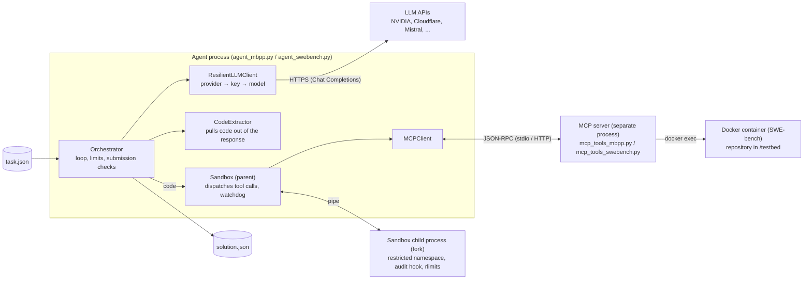
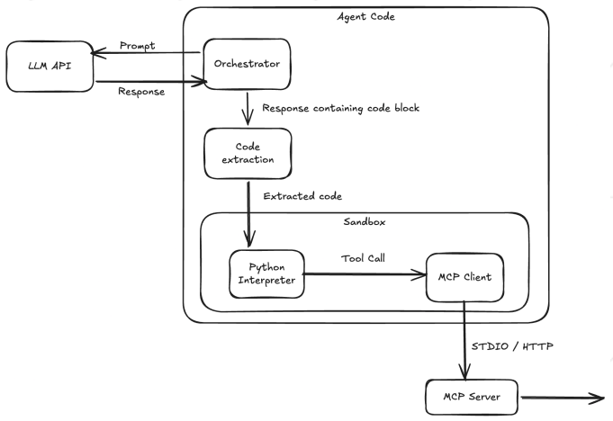
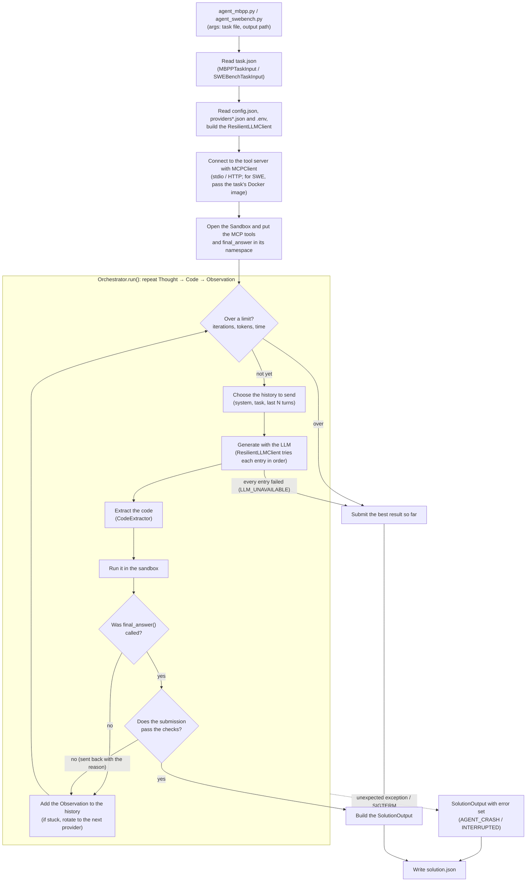
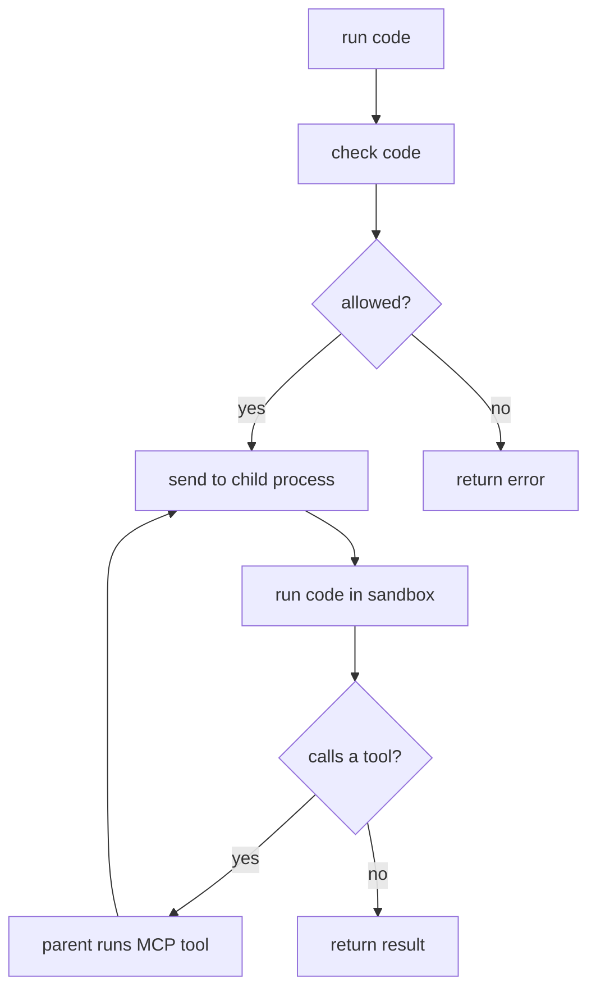

*This project has been created as part of the 42 curriculum by ayhirose, nsato, joseo.*

<table>
	<thead>
    	<tr>
      		<th style="text-align:center">English</th>
      		<th style="text-align:center"><a href="README_ja.md">Japanese</a></th>
    	</tr>
  	</thead>
</table>

<h1>
	AgentSmith
</h1>
<H2>
	An LLM coding agent, built from scratch, that solves MBPP and SWE-bench tasks
</H2>


## 📖*Contents*
1. [💡Description](#1-description)
2. [📁File Structure](#2-file-structure)
3. [✅Instructions](#3-instructions)
4. [⛏Additional Requirements](#4-additional-requirements)
5. [🌈Resources](#5-resources)
	1. [References](#5-1-references)
	2. [AI Usage](#5-2-ai-usage)


## 💡1. Description

AgentSmith is an LLM agent that works on programming tasks by itself: it thinks, writes code, runs it to check the result, and fixes it, over and over.
It supports two benchmarks:

- **MBPP**: write a Python function from a short problem statement
- **SWE-bench**: fix an issue in a real open-source repository with a patch (`git diff`)

The system is made of three components.

| Component | Role | Owner |
|---|---|---|
| Agent | Calls the LLM, runs the think-and-act loop, extracts the answer | nsato |
| Sandbox | Runs the code written by the LLM in an isolated environment | joseo |
| MCP | A server that provides tools, and a client that calls them | ayhirose |

### 1-1. System architecture



| Component | Responsibility | Code |
|---|---|---|
| Orchestrator | The Thought → Code → Observation loop: checks the limits, chooses the history to send, checks the submission | `src/agent/orchestrator.py` |
| ResilientLLMClient | Tries "provider → key → model" entries in the order of `providers*.json`; handles 429, 5xx, etc. | `src/agent/llm/` |
| CodeExtractor | Pulls Python code out of the LLM's response (Markdown, XML, JSON, ReAct) | `src/agent/extractor/` |
| Sandbox | Runs the LLM's code in a forked child process. The parent dispatches tool calls and watches the child | `src/sandbox/` |
| MCPClient / MCP server | Call tools over JSON-RPC 2.0. The server is a separate process (a stdio child process, or HTTP) | `src/mcp/`, `mcp_tools_*.py` |
| Executor (SWE-bench) | Starts a container from the task's Docker image and runs each tool inside it with `docker exec` | `src/mcp/swe_bench/` |

- **The LLM's code** runs in a forked child process. The child can neither use the network nor create processes, so to call a tool it asks the parent through a pipe. The parent calls the server with the MCPClient and sends the result back to the child.
- **Tools run** in the MCP server's process, and for SWE-bench inside the task's Docker container. Code that the LLM passes as a tool argument (such as `run_tests(code=...)`) runs there, not in the sandbox.
- **Only the LLM APIs** go out to the external network. Which providers to use is set in `providers*.json`; the Orchestrator does not know about providers (it depends only on the `LLMGenerator` interface).
- **Settings**: limits in `config.json`, providers in `providers/providers*.json`, the sandbox in `sandbox_template.json`, API keys in `.env`.


## 📁2. File Structure

```
.
├── agent_mbpp.py          # Entry point for MBPP
├── agent_swebench.py      # Entry point for SWE-bench
├── mcp_tools_mbpp.py      # MCP server for MBPP
├── mcp_tools_swebench.py  # MCP server for SWE-bench
├── providers/             # LLM provider and model settings
├── src/
│   ├── agent/             # Agent (LLM, prompts, extraction, orchestrator)
│   ├── sandbox/           # Sandbox
│   ├── mcp/               # Our own MCP implementation (models / server / client)
│   │   └── swe_bench/     # Executor for SWE-bench (local / Docker)
│   ├── config/            # Loading settings
│   └── models/            # Input and output models
└── test/                  # Tests (MCP tests are in test/mcp/)
```


## ✅3. Instructions

### 3-1. Requirements
- Python 3.10
- [uv](https://docs.astral.sh/uv/) (you can also install it with `make uv-install`)
- Docker (needed to run SWE-bench and to evaluate with the moulinette)
- An API key for an LLM (OpenRouter or Groq)
- The moulinette provided with the subject (`moulinette.zip`)

### 3-2. Folder layout
Put the moulinette (the evaluation tool provided with the subject) at the same level as this repository.
The task and solution JSON files are written to `cache/` at the same level.

```
<work folder>/
├── moulinette/      # the extracted moulinette.zip
├── AgentSmith/      # this repository
└── cache/           # task.json and solution.json (created by the moulinette)
```

### 3-3. Setup
```bash
# Agent
cd AgentSmith
make install          # create the virtual environment and install the dependencies
cp .env.example .env  # fill in OPENROUTER_API_KEY / GROQ_API_KEY

# moulinette
cd ../moulinette
uv sync
```

### 3-4. Evaluate with the moulinette
The moulinette's `quickstart.sh` runs the following three steps with one command.

1. Get a task (dump)
2. Run the agent with a time limit (run-agent)
3. Evaluate the solution (validate)

```bash
cd moulinette

# MBPP (time limit: 120 seconds)
./quickstart.sh mbpp --student-path ../AgentSmith \
  --model-name "model/name" --provider-url "https://provider.api/v1"

# SWE-bench (time limit: 900 seconds)
./quickstart.sh swebench --student-path ../AgentSmith \
  --model-name "model/name" --provider-url "https://provider.api/v1"
```
- `--task-id` selects a task (e.g. `--task-id 42`, `--task-id sympy__sympy-23534`).
- `--seed` fixes the randomly chosen task.
- `--cache-dir` changes where the JSON files are written (default: `../cache`).
- Run `./quickstart.sh --help` to see all options.

### 3-5. Run the moulinette step by step
Run the steps of `quickstart.sh` one at a time.

```bash
cd moulinette

# 1. Get a task
uv run moulinette_eval dump mbpp --output ../cache/mbpp_task.json
uv run moulinette_eval dump swebench --task-id sympy__sympy-23534 --output ../cache/swebench_task.json

# 2. Run the agent with a time limit
uv run moulinette_eval run-agent 120 \
  "cd ../AgentSmith && uv run python -m agent_mbpp --task-file ../cache/mbpp_task.json --output ../cache/mbpp_solution.json"

# 3. Evaluate the solution
uv run moulinette_eval validate mbpp ../cache/mbpp_task.json ../cache/mbpp_solution.json
uv run moulinette_eval validate mbpp ../cache/mbpp_task.json ../cache/mbpp_solution.json --skip-metrics
uv run moulinette_eval validate_metrics mbpp ../cache/mbpp_solution.json

# 4. Look at the solution
uv run moulinette_eval display ../cache/mbpp_solution.json --full
```
- Running `moulinette_eval` with no arguments shows the list of commands.

### 3-6. Run without the moulinette
If you already have a task.json, you can run the agent directly.

```bash
cd AgentSmith

# MBPP
uv run python3 -m agent_mbpp \
  --task-file ../cache/mbpp_task.json \
  --output ../cache/mbpp_solution.json \
  --model-name "model/name" --provider-url "http://provider.api/v1"

# SWE-bench
uv run python3 -m agent_swebench \
  --task-file ../cache/swebench_task.json \
  --output ../cache/swebench_solution.json \
  --model-name "model/name" --provider-url "http://provider.api/v1"
```
If you leave out `--model-name` and `--provider-url`, the defaults in `providers/providers.json` are used.


### 3-7. Evaluation criteria
Besides checking that the solution is correct, the moulinette checks that it stays within these limits.

| Metric | MBPP | SWE-bench |
|---|---|---|
| Maximum iterations | 10 | 30 |
| Maximum input tokens | 6,000 | 300,000 |
| Maximum output tokens | 1,500 | 10,000 |
| Time limit | 120 seconds | 900 seconds |
| Pass threshold | 4 of 5 random tasks | 2 of 3 random tasks |

### 3-8. Makefile targets
| Target | What it does |
|---|---|
| `install` | Create the virtual environment and install the dependencies |
| `run` / `debug` | Run / run under pdb for debugging |
| `lint` / `lint-strict` | Static analysis with flake8 and mypy / a stricter version |
| `clean` / `fclean` / `re` | Remove caches / also remove the virtual environment / rebuild |


## ⛏4. Additional Requirements

### 4-1. Agent
The agent is a loop that makes the LLM repeat "Thought → Code → Observation" (`src/agent/`).
MBPP and SWE-bench run on the same loop. The only differences are the prompts, how the submission is handled, and the limit values; each benchmark keeps these in its own settings object (`TaskProfile`).

#### Overall flow



- The Orchestrator depends only on interfaces (`LLMGenerator`, `CodeExtractor`, `SandboxBase`, `TaskProfile`). So the provider, the extraction format, the sandbox and the benchmark can be swapped without touching the loop.

#### One iteration
1. **Check the limits**: stop if the number of iterations, the total input or output tokens, or the elapsed time (plus a margin: 10 seconds for MBPP, 60 seconds for SWE) is over its limit.
2. **Choose the history to send**: Chat Completions keeps no state, so the history is sent again every time. Only these three are sent:
   - the system prompt
   - the task statement
   - the last N turns (one turn = the LLM's response + the Observation; N=2 for MBPP, 6 for SWE)

   Each message longer than its character limit is shortened by **cutting out the middle** (so that the advice at the end is kept).
   Before sending, the input tokens are estimated (characters ÷ 3.0, lowered to match what the provider actually counts), and N is reduced until the total fits in the limit. If even the system prompt and the task statement do not fit, the agent stops without sending.
3. **Generate**: the stop string is `<end_code>`. The output limit of one call is `min(per-call limit, remaining output)` (per-call limit: 600 for MBPP, 1,200 for SWE).
4. **Extract the code**: besides ```` ```python ```` blocks, tool calls in XML, JSON (Hermes) and ReAct formats are converted into Python. Broken output is repaired and run, and the LLM is told what was repaired with `[MALFORMED_CODE]`. The repairs cover:
   - unclosed blocks and code without fences
   - extra escapes and extra closing brackets
   - the `{"code": ...}` form
   - multiple blocks
5. **Run and observe**: the code runs in the sandbox, and the result is summarized as:
   - a status label (`[OK]`, `[EXCEPTION]`, `[TIMEOUT]`, `[TRUNCATED]`, `[NO_CODE]`)
   - stdout, the value of the last expression, the error, and a hint on how to fix it
   - `[REPEATED]` if the code is the same as before, and `[BUDGET]` if little budget is left
6. **Check the submission**: when `final_answer(...)` is called, the agent checks it before accepting it. If it fails, it is sent back with the reason.
   - MBPP: three checks:
     - it is valid function source code
     - it passes the visible tests (actually run with `run_tests`)
     - it does not hard-code the answers of the visible tests
   - SWE-bench: it is a git diff (`final_answer(get_patch())`)
7. **When stuck, switch provider**: when the same model makes no progress, the provider that answered last is moved to the back (a different model makes different mistakes).
   - MBPP: two iterations in a row without an accepted submission
   - SWE: the same code twice in a row

Even when the agent stops without submitting, it submits the best result it has. For MBPP, that is the last function that ran without errors. For SWE, it is `get_patch()` of the container at that point.

#### Calling the LLM and retrying (`ResilientLLMClient`)
- The "provider → key → model" entries are ordered by `priority` in `providers/providers.json` (MBPP) and `providers_swebench.json` (SWE). Every call starts from the first entry.
  - Keys are used in the order `XXX_API_KEY`, `XXX_API_KEY_2`, ...
  - Per-model settings, such as turning reasoning off, go in `model_params`.
- How each kind of failure is handled:

| Failure | Handling |
|---|---|
| 429 (rate limit, quota used up) | Move to the next entry without waiting |
| 5xx, network errors | Wait 1, 2, ... seconds (up to 8) and resend to the same entry, up to 2 times |
| 401/403, 400, empty response, unreadable response | Move to the next entry, and put this entry last for the rest of the task |

- If every entry fails and a 429 was among the failures, the client waits once and tries one more round, as long as the wait fits in the remaining time. If that also fails, the agent ends with `LLM_UNAVAILABLE` (it does not crash).
- HTTP timeouts and waits are kept shorter than the remaining time, so that the agent stops by itself before the grader's SIGTERM.

#### Provider order in production (chosen by measurement; see [`BENCHMARK_REPORT.md`](BENCHMARK_REPORT.md) for details)
- MBPP: we ran all 257 tasks in the exam's range and got 237/257 (92.2%).
  - First is codestral (fast). Its free key now allows only 2 requests per minute, so in the exam it answers the first requests and the rest go on to the next models.
  - Second is qwen3.8 (Groq), which had the highest pass rate on the hard tasks, and third is gpt-oss-120b (Cloudflare), which passed most of the tasks codestral could not pass in the full runs.
- SWE-bench: first is NVIDIA glm-5.3-flash (17/18 on the 6 candidate exam tasks × 3 rounds with a single model, 24/24 on 11-11, and 6/6 with this order on 11-12), and second is gpt-oss-120b (low) on Cloudflare (13/13).
  - Until 11-09, gpt-oss:120b (low) on Ollama was first (18/18, 9/9 even on the hardest one, sympy-14711). Ollama Cloud's free plan became pay-as-you-go on 11-09, so we removed Ollama from both orders.
- Stronger reasoning settings are not used: they tended to hit SWE's output limit (10,000) and did not raise the pass rate.
- Put the keys of the providers listed here in `.env` (`MISTRAL_API_KEY`, `GROQ_API_KEY`, `GEMINI_API_KEY`, `KILO_API_KEY`, `NVIDIA_API_KEY`, `CLOUDFLARE_API_KEY`, `COHERE_API_KEY`). Providers without a key are skipped.

#### Limits and token counting
| Limit (`config.json`) | MBPP | SWE-bench |
|---|---|---|
| Iterations | 10 | 30 |
| Input tokens (total for the task) | 6,000 | 300,000 |
| Output tokens (total, including reasoning tokens) | 1,500 | 10,000 |
| Output limit of one call | 600 | 1,200 |
| Time limit | 120 seconds | 900 seconds |

- Tokens are counted from the `usage` returned by the provider. Hidden reasoning tokens (the amount by which `total − prompt` exceeds `completion`) and tokens spent on empty responses are added too.
- When the body is empty and only the reasoning text comes back, the reasoning text is used in place of the body.

#### How a run ends, and what is recorded
- `solution.json` is written however the run ends.
  - Unexpected exception: `error="AGENT_CRASH: …"`
  - SIGTERM or Ctrl+C: `error="INTERRUPTED: …"`
  - Stopped by a limit: `MAX_ITERATIONS`, `MAX_INPUT_TOKENS`, `MAX_OUTPUT_TOKENS`, `TIME_LIMIT`
  - Every LLM failed: `LLM_UNAVAILABLE`
- The `steps` in `solution.json` keep, for each iteration:
  - the LLM's output
  - the code that was run, and the Observation
  - input and output tokens, response time, model name, and number of retries
- Provider switches and failures are logged to stderr with the logger `agent.llm`.

#### **Benchmark Results and Analysis**
- The benchmark results for both MBPP and SWE-Bench, along with the corresponding analysis, are documented in [`BENCHMARK_REPORT.md`](BENCHMARK_REPORT.md).

### 4-2. Sandbox

#### Isolation

The sandbox enforces three independent layers.

1. Restricted namespace (first layer)
	LLM code runs in a fresh namespace whose builtins have the dangerous ones removed and whose `__import__` is guarded to the config's `authorized_imports`. A static AST pass rejects disallowed imports, dunder access, and `module._private` access before anything runs. This layer is cheap but bypassable on its own, so it sits in front of the real boundary.
```python
_BLOCKED = frozenset({
    "eval", "exec", "compile", "__import__", "globals", "locals", "vars",
    "getattr", "setattr", "breakpoint", "input", "exit", "quit",
})
```

2. Runtime audit hook (the real boundary)
	A PEP 578 audit hook watches operations, not names, so it catches an escape however it was reached (e.g. `typing.sys.modules['os'].system`). It denies process creation, ctypes, heap inspection, and network operations (`socket.connect`/`bind`/`getaddrinfo`), and confines file access to `allowed_directories`. Socket constructors are also neutered as a second layer.

3. Process isolation
	LLM code runs in a forked child. Memory is capped with `RLIMIT_AS` and time with an interval timer, both set in the child - they can only apply to a separate process, not the agent itself. The parent dispatches tool calls and acts as a watchdog, killing and restarting the worker if it goes unresponsive. The child's environment is scrubbed at startup so inherited API keys are not readable.

	The execution timeout is paused during tool calls, because tools run outside the sandbox and their runtime must not count against the budget.

The restricted namespace is a first filter and is bypassable on its own; the audit hook (operations) and process isolation (rlimits) are the real guarantees. A fully adversarial deployment would additionally run the child in a container. Security mechanisms use only the Python standard library; pydantic is used only for config.



#### final_answer
A callable injected into the namespace for the LLM to call when it believes its solution is correct. It raises a `FinalAnswer` exception that inherits from `BaseException`, so generated code wrapping its work in `try/except Exception` cannot swallow the task-complete signal.

#### manual()
Generates the text describing the sandbox to the LLM - the rules, `final_answer` usage, and the connected server's tools (and resources / prompts) - built from the live schema so it reflects whichever MCP server is connected. This text goes into the system prompt.

#### REPL

```bash
# test the sandbox REPL
uv run python -m src.sandbox.sandbox_main (config)

# test with an MCP server (stdio / HTTP)
uv run python -m src.sandbox.sandbox_main (config) --mcp-stdio (stdio command) or --mcp-server (server URL)

# run one piece of code
uv run python -m src.sandbox.sandbox_main (config) -c "code"
```

Example session (`.tools` prints the text given to the LLM):

```text
sandbox - 'exit' or Ctrl-D to quit
>>> def add(x, y):
...     return x + y
>>> print(add(1, 2))
3
>>> eval()
use of 'eval' is not allowed
>>> .tools
# Sandbox

Your code runs in a restricted Python namespace.
State persists between steps: names you define stay defined.

## Rules
- Imports allowed: array, bisect, cmath, collections, collections.*, copy, datetime, datetime.*, functools, heapq, itertools, json, math, math.*, operator, random, re, string, typing, typing.*
- File access limited to: /testbed, /tmp/agent
- No network access.
- Execution time limit: 30s (tool calls are not counted against this limit).
- Memory limit: 512MB.
- Unavailable: __import__, breakpoint, compile, eval, exec, exit, getattr, globals, input, locals, quit, setattr, vars
- Dunder attribute access (__class__, __globals__) is blocked.

## final_answer

final_answer(value) ends the task. It is always available and
is not an MCP tool. Call it once you have a verified answer.

## Tools

Call these as normal Python functions; keyword or positional arguments are accepted.

run_tests(code: str, test_list: list)
   Run candidate solution code against a list of assert statements.

Returns a JSON string with "success" (True if all tests passed),
"message" and "output" (stdout and stderr of the run).


## Resources

Read with read_resource(uri=...) Available:
mbpp://guide/run_tests (run_tests_guide)
  How to call run_tests and read its result.

## Prompts

Fetch with get_prompt(name=..., arguments={...}). Available:
solve_task(task_definition, function_definition, tests)
  Build the instruction for solving one MBPP task.
```

#### Config for the sandbox

Limits and permissions are a pydantic `SandboxConfig`, loaded from a JSON file (`sandbox_template.json` at the repo root):

| Field | Meaning | Default |
|---|---|---|
| `authorized_imports` | import allowlist (`x.*` permits submodules) | math, collections, … |
| `allowed_directories` | where file I/O is permitted | /testbed, /tmp/agent |
| `max_execution_time_seconds` | per-snippet timeout | 30 |
| `max_memory_mb` | `RLIMIT_AS` cap | 512 |
| `max_output_chars` | stdout/stderr truncation threshold | 8000 |

Precedence: code defaults -> JSON file. Blocked builtins are fixed in code (`_BLOCKED`), not in the config.

#### Security boundary - what the sandbox does and does not cover

The sandbox confines the *snippet it executes*. Code the LLM passes as a *tool argument* (e.g. `run_tests(code="...")`) is NOT checked by the sandbox - it crosses the pipe as data and runs in the MCP server's environment (a Docker container for SWE-bench). These are two independent security domains: the sandbox guards the interpreter; the server's container guards the candidate code. Neither inspects the other.

#### MCP integration

Connects over stdio (`--mcp-stdio "cmd"`) or streamable HTTP (`--mcp-server URL`). Tools, resources, and prompts are discovered at connect time and exposed dynamically, so an unknown server's tools appear automatically - the manual and the callable stubs are built from its live schema. Tools accept keyword *or* positional arguments (mapped by schema order).

#### Feedback (ExecuteResult)

Every run returns an `ExecuteResult`: `stdout`, `stderr`, `value`, `error`, `timeout`, `truncated`, `final_answer`, `final_answer_bool`.
The sandbox gives explicit feedback in each failure case - a denied operation returns a one-line reason, a timeout returns partial output with `timeout=True`, oversized output is cut with a marker and `truncated=True`, and an unknown tool name is reported with the closest match.

### 4-3. MCP

We implemented both the server and the client following the MCP specification (JSON-RPC 2.0), using only the standard library and pydantic.
The official `mcp` SDK is used only as the other end in tests that check the two can talk to each other.

- **models**: JSON-RPC and MCP messages as pydantic models
- **server**: register with the decorators `@server.tool()`, `@server.resource(uri)` and `@server.prompt()`; supports the `tools`, `resources` and `prompts` methods
- **client**: connect with `MCPClient(transport)`, then call `list_tools` / `call_tool` / `list_resources` / `read_resource` / `list_prompts` / `get_prompt`

#### Two transports
| | Server | Client |
|---|---|---|
| stdio | Reads and writes standard input/output one line at a time | Starts the server as a child process |
| Streamable HTTP | HTTP over `socket`. Replies with one JSON response per request, and assigns an `Mcp-Session-Id` | Reads JSON and SSE with `http.client`. With the default URL, it starts the server automatically |

#### Server for MBPP (`mcp_tools_mbpp.py`)
- Tool `run_tests(code, test_list)`: runs the code with the tests and returns the result
- Resource `mbpp://guide/run_tests`, prompt `solve_task`
- `--transport stdio|http`, `--port` (default: 8000)

#### Server for SWE-bench (`mcp_tools_swebench.py`)
- Provides the 9 tools required by the subject: `read_file`, `edit_file`, `list_files`, `search_code`, `search_function_or_class_definition_in_code`, `find_references`, `run_tests`, `get_patch`, `run_command`
- **Docker management**: starts a container at initialize, and runs each tool inside the container with `docker exec`
- **Settings come in `_meta["agentsmith/swebench"]` of initialize** (Docker image, eval_script).
- Without `_meta`, it uses the environment variable `TESTBED_PATH` and works on a local directory without Docker (for the moulinette's standalone tool tests)
- **Container cleanup**: stops and removes the container when it receives SIGTERM or when standard input is closed.


## 🌈5. Resources

### 5-1. References
- [Model Context Protocol specification](https://modelcontextprotocol.io/specification)
- [JSON-RPC 2.0 specification](https://www.jsonrpc.org/specification)
- [MBPP](https://github.com/google-research/google-research/tree/master/mbpp)
- [SWE-bench](https://www.swebench.com/)
- [Docker documentation](https://docs.docker.com/)
- Agent:
  - Yao et al., [ReAct: Synergizing Reasoning and Acting in Language Models](https://arxiv.org/abs/2210.03629) (ICLR 2023)
  - Wang et al., [Executable Code Actions Elicit Better LLM Agents (CodeAct)](https://arxiv.org/abs/2402.01030) (ICML 2024): the idea of calling tools with code instead of JSON
  - Jimenez et al., [SWE-bench: Can Language Models Resolve Real-World GitHub Issues?](https://arxiv.org/abs/2310.06770) (ICLR 2024)
  - APIs:
  [mistral.ai](https://mistral.ai/products/studio/)
  [groq](https://console.groq.com/home)
  [gemini](https://aistudio.google.com/prompts/)
  [kilo](https://app.kilo.ai/)
  [nvidia](https://build.nvidia.com/settings/api-keys)
  [cloudflare](https://dash.cloudflare.com/login)
  [cohere](https://dashboard.cohere.com/welcome/login)
  [openrouter](https://openrouter.ai/)


### 5-2. AI Usage
<!-- Each member writes for which tasks and which parts they used AI -->
- **ayhirose (MCP)**: explanations of the MCP, HTTP and SSE specifications, a sounding board for the design, and writing the test scripts (`test/mcp/`). Some of the SWE-bench tools were based on generated code, which was then fixed and merged.
- **nsato (Agent)**: used Claude Code as someone to consult on questions and as an analyst.
  - **Design**: a sounding board for the agent loop, provider switching and how to handle the limits. Which option to take was decided by myself (the team).
  - **Implementation**: received code proposals with a line-by-line explanation, read and understood them, then typed them in myself and tested them.
  - **Testing and measurement**: used for designing unit tests and for the measurement scripts. Also used to read the `solution.json` of failed runs and find the cause.
  - **Documentation**: used for drafting the Agent section of this README and the benchmark report. All the numbers come from actual measurements.
- **joseo (Sandbox)**: Used AI for learning the way to implement a sandbox that is isolated. Used for debugging.
