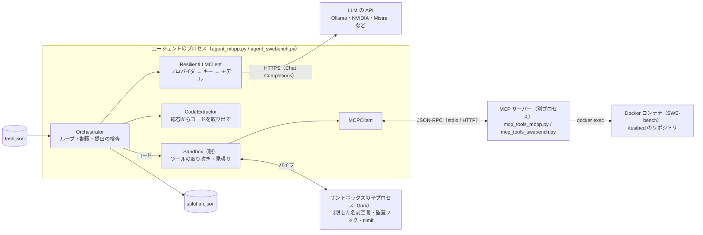
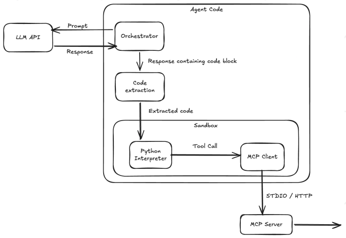
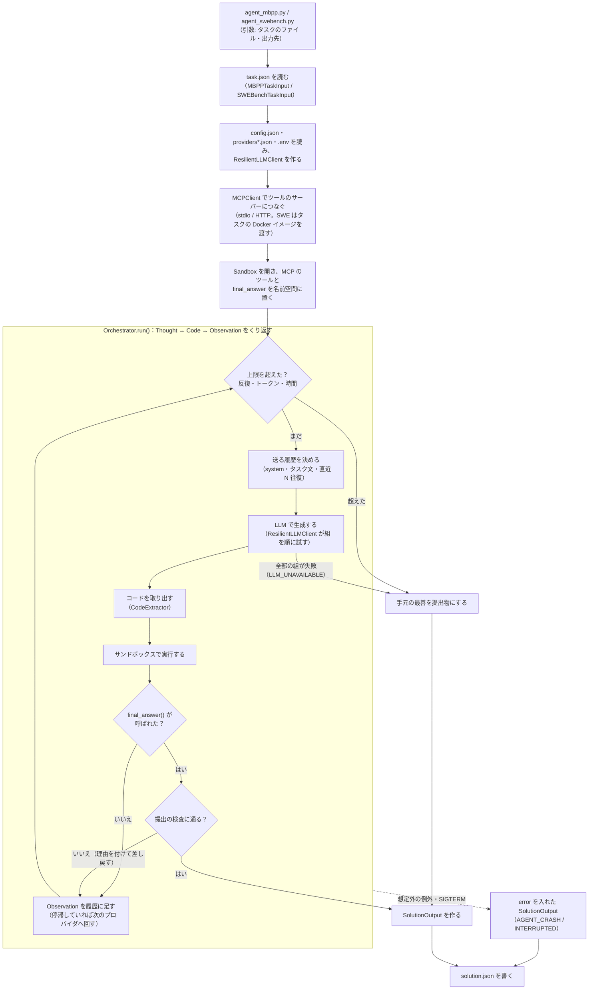
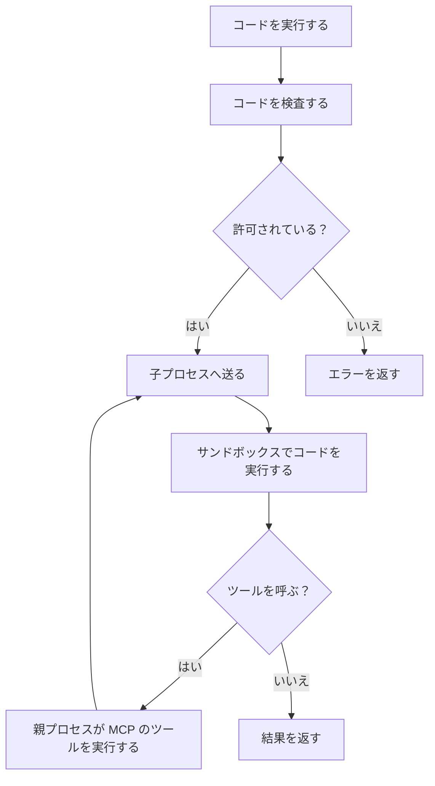

*This project has been created as part of the 42 curriculum by ayhirose, nsato, joseo.*

<table>
	<thead>
    	<tr>
      		<th style="text-align:center"><a href="README.md">英語</a></th>
      		<th style="text-align:center">日本語</th>
    	</tr>
  	</thead>
</table>

<h1>
	AgentSmith
</h1>
<H2>
	MBPP と SWE-bench を解く、自作の LLM コーディングエージェント
</H2>


## 📖*目次*
1. [💡概要](#1-概要)
2. [📁ファイル構成](#2-ファイル構成)
3. [✅手順](#3-手順)
4. [⛏追加要件](#4-追加要件)
5. [🌈リソース](#5-リソース)
	1. [参考URL](#5-1-参考url)
	2. [AIの使用について](#5-2-aiの使用について)


## 💡1. 概要

AgentSmith は、プログラミングの課題を自分で考え、コードを書き、実行して確かめ、直すことをくり返す LLM エージェントです。
次の2つのベンチマークに対応しています。

- **MBPP**：短い問題文から Python の関数を書く
- **SWE-bench**：実際の OSS リポジトリの issue を、パッチ（`git diff`）で直す

システムは、3つの部品でできています。

| 部品 | 役割 | 担当 |
|---|---|---|
| Agent | LLM の呼び出し、思考と行動のループ、答えの取り出し | nsato（要確認） |
| Sandbox | LLM が書いたコードを、隔離した環境で実行する | joseo（要確認） |
| MCP | ツールを提供するサーバーと、それを呼ぶクライアント | ayhirose |

### システムアーキテクチャ



| 部品 | 受け持つこと | コード |
|---|---|---|
| Orchestrator | Thought → Code → Observation のループ。制限の確認・送る履歴の選択・提出の検査 | `src/agent/orchestrator.py` |
| ResilientLLMClient | `providers*.json` の並びで「プロバイダ → キー → モデル」を順に試す。429・5xx などの扱い | `src/agent/llm/` |
| CodeExtractor | LLM の応答から Python のコードを取り出す（Markdown・XML・JSON・ReAct） | `src/agent/extractor/` |
| Sandbox | LLM のコードを、fork した子プロセスで実行する。親はツールの呼び出しを取り次ぎ、子を見張る | `src/sandbox/` |
| MCPClient / MCP サーバー | ツールを JSON-RPC 2.0 で呼ぶ。サーバーは別のプロセス（stdio の子プロセスか HTTP） | `src/mcp/`・`mcp_tools_*.py` |
| Executor（SWE-bench） | タスクの Docker イメージでコンテナを起動し、ツールを `docker exec` で中で実行する | `src/mcp/swe_bench/` |

- **LLM のコード**は、fork した子プロセスで動きます。子はネットワークもプロセスの作成もできないので、ツールを呼ぶときは、パイプで親に頼みます。親が MCPClient でサーバーを呼び、結果を子に返します。
- **ツールの実行**は、MCP サーバーのプロセスで行います。SWE-bench では、さらにタスクごとの Docker のコンテナの中です。LLM がツールの引数として渡したコード（`run_tests(code=...)` など）は、サンドボックスではなく、こちらの環境で動きます。
- **LLM の API** だけが、外部のネットワークに出ます。どのプロバイダを使うかは `providers*.json` で決め、Orchestrator はプロバイダを知りません（インターフェースの `LLMGenerator` にだけ依存します）。
- **設定**は、制限が `config.json`、プロバイダが `providers/providers*.json`、サンドボックスが `sandbox_template.json`、API キーが `.env` です。


## 📁2. ファイル構成

```
.
├── agent_mbpp.py          # MBPP のエントリーポイント
├── agent_swebench.py      # SWE-bench のエントリーポイント
├── mcp_tools_mbpp.py      # MBPP 用の MCP サーバー
├── mcp_tools_swebench.py  # SWE-bench 用の MCP サーバー
├── providers/             # LLM プロバイダーとモデルの設定
├── src/
│   ├── agent/             # エージェント（LLM、プロンプト、抽出、オーケストレーター）
│   ├── sandbox/           # サンドボックス
│   ├── mcp/               # 自作の MCP（models / server / client）
│   │   └── swe_bench/     # SWE-bench 用の Executor（ローカル / Docker）
│   ├── config/            # 設定の読み込み
│   └── models/            # 入出力のモデル
└── test/                  # テスト（MCP は test/mcp/）
```


## ✅3. 手順

### 3-1. 必要なもの
- Python 3.10
- [uv](https://docs.astral.sh/uv/)（`make uv-install` でもインストールできます）
- Docker（SWE-bench の実行と、moulinette での評価に必要）
- LLM の API キー（OpenRouter または Groq）
- 課題で配布される moulinette（`moulinette.zip`）

### 3-2. フォルダの配置
課題で配布される moulinette（評価ツール）を、このリポジトリと同じ階層に置きます。
タスクと解答の JSON は、同じ階層の `cache/` に書き出されます。

```
<作業フォルダ>/
├── moulinette/      # 配布された moulinette.zip を展開したもの
├── AgentSmith/   # このリポジトリ
└── cache/           # task.json と solution.json（moulinette が作る）
```

### 3-3. セットアップ
```bash
# エージェント
cd AgentSmith
make install          # 仮想環境の作成と依存関係のインストール
cp .env.example .env  # OPENROUTER_API_KEY / GROQ_API_KEY を記入する

# moulinette
cd ../moulinette
uv sync
```

### 3-4. moulinette で評価する
moulinette の `quickstart.sh` を使うと、次の3つを1回のコマンドで実行できます。

1. タスクの取得（dump）
2. 制限時間つきでのエージェントの実行（run-agent）
3. 解答の評価（validate）

```bash
cd moulinette

# MBPP（制限時間 120秒）
./quickstart.sh mbpp --student-path ../AgentSmith \
  --model-name "model/name" --provider-url "https://provider.api/v1"

# SWE-bench（制限時間 900秒）
./quickstart.sh swebench --student-path ../AgentSmith \
  --model-name "model/name" --provider-url "https://provider.api/v1"
```
- `--task-id` で問題を指定できます（例：`--task-id 42`、`--task-id sympy__sympy-23534`）。
- `--seed` で、ランダムに選ばれる問題を固定できます。
- `--cache-dir` で、JSON の書き出し先を変えられます（既定は `../cache`）。
- オプションの一覧は `./quickstart.sh --help` で確認できます。

### 3-5. Moulinette マニュアル実行
`quickstart.sh` を1段階ずつ実行する。

```bash
cd moulinette

# 1. タスクを取得する
uv run moulinette_eval dump mbpp --output ../cache/mbpp_task.json
uv run moulinette_eval dump swebench --task-id sympy__sympy-23534 --output ../cache/swebench_task.json

# 2. 制限時間つきでエージェントを実行する
uv run moulinette_eval run-agent 120 \
  "cd ../AgentSmith && uv run python -m agent_mbpp --task-file ../cache/mbpp_task.json --output ../cache/mbpp_solution.json"

# 3. 解答を評価する
uv run moulinette_eval validate mbpp ../cache/mbpp_task.json ../cache/mbpp_solution.json
uv run moulinette_eval validate mbpp ../cache/mbpp_task.json ../cache/mbpp_solution.json --skip-metrics
uv run moulinette_eval validate_metrics mbpp ../cache/mbpp_solution.json

# 4. 解答の中身を見る
uv run moulinette_eval display ../cache/mbpp_solution.json --full
```
- `moulinette_eval` を引数なしで実行すると、コマンドの一覧が表示されます。


### 3-6. moulinette を使わずに実行する
すでに task.json がある場合は、エージェントを直接実行できます。

```bash
cd AgentSmith

# MBPP
uv run python3 -m agent_mbpp \
  --task-file ../cache/mbpp_task.json \
  --output ../cache/mbpp_solution.json \
  --model-name "model/name" --provider-url "http://provider.api/v1"

# SWE-bench
uv run python3 -m agent_swebench \
  --task-file ../cache/swebench_task.json \
  --output ../cache/swebench_solution.json \
  --model-name "model/name" --provider-url "http://provider.api/v1"
```
`--model-name` と `--provider-url` を省略すると、`providers/providers.json` の既定値を使います。

### 3-7. 評価の基準
moulinette は、解答が正しいかに加えて、次の制限を守っているかも確認します。

| 指標 | MBPP | SWE-bench |
|---|---|---|
| ループの最大回数 | 10 | 30 |
| 入力トークンの上限 | 6,000 | 300,000 |
| 出力トークンの上限 | 1,500 | 10,000 |
| 制限時間 | 120秒 | 900秒 |
| 合格の基準 | ランダムな5問のうち4問 | ランダムな3問のうち2問 |

### 3-8. Makefile のターゲット
| ターゲット | 内容 |
|---|---|
| `install` | 仮想環境の作成と依存関係のインストール |
| `run` / `debug` | 実行 / pdb でのデバッグ実行 |
| `lint` / `lint-strict` | flake8・mypy による静的解析 / より厳しい解析 |
| `clean` / `fclean` / `re` | キャッシュの削除 / 仮想環境も削除 / 作り直し |


## ⛏4. 追加要件

### 4-1. Agent
Agentは、LLMに「考え（Thought）→ コード（Code）→ 実行結果（Observation）」をくり返させるループです（`src/agent/`）。
MBPP と SWE-bench は同じループで動きます。2つの違いは、プロンプト・提出物の扱い・制限の値だけで、これをタスクごとの設定（`TaskProfile`）が持ちます。

#### 全体の流れ



- Orchestrator はインターフェース（`LLMGenerator`・`CodeExtractor`・`SandboxBase`・`TaskProfile`）にだけ依存します。そのため、プロバイダ・取り出しの形式・サンドボックス・ベンチマークを、ループに手を入れずに差し替えられます。

#### 1回の反復
1. **上限の確認**：反復の回数、入力・出力トークンの合計、経過時間（＋余白：MBPP 10秒・SWE 60秒）のどれかを超えていれば終わる。
2. **送る履歴を決める**：Chat Completions は状態を持たないので、毎回、履歴を送り直します。送るのは次の3つだけです。
   - system プロンプト
   - タスク文
   - 直近 N 往復（1往復＝LLM の応答＋Observation。MBPP は N=2、SWE は 6）

   1件ずつ上限の文字数を超えた分は、**真ん中を省いて**縮めます（末尾の助言を残すため）。
   送る前に入力トークンを見積もり（文字数 ÷ 3.0。実測に合わせて小さいほうへ直す）、合計の上限に収まるまで N を減らします。system とタスク文だけでも収まらなければ、送らずに終わります。
3. **生成**：停止文字列は `<end_code>` です。1回の出力の上限は、`min(1回の上限, 出力の残り)` にします（1回の上限は MBPP 600・SWE 1,200）。
4. **コードの取り出し**：```` ```python ```` のブロックのほか、XML・JSON（Hermes）・ReAct 形式のツール呼び出しも Python に直します。崩れた出力も、直して実行します。何を直したかは、`[MALFORMED_CODE]` で LLM に伝えます。直す対象は次のとおりです。
   - 閉じていないブロック、フェンスの無いコード
   - 余分なエスケープや、余分な閉じ括弧
   - `{"code": ...}` の形
   - 複数のブロック
5. **実行と Observation**：サンドボックスで実行し、結果を次の形にまとめます。
   - 状態のラベル（`[OK]`・`[EXCEPTION]`・`[TIMEOUT]`・`[TRUNCATED]`・`[NO_CODE]`）
   - stdout、最後の式の値、エラー、直し方の助言
   - 前と同じコードなら `[REPEATED]`、残りが少なければ `[BUDGET]` を付けます。
6. **提出の検査**：`final_answer(...)` が呼ばれたら、受け取る前に確かめます。通らなければ、理由を付けて差し戻します。
   - MBPP：次の3つを確かめます。
     - 関数のソースとして正しいか
     - 見えているテストに通るか（`run_tests` で実際に通す）
     - 見えているテストの答えを直書きしていないか
   - SWE-bench：git の diff になっているか（`final_answer(get_patch())`）
7. **停滞したら別のプロバイダへ**：同じモデルで進まないときは、直前に答えたプロバイダを後ろに回します（モデルが違うと、間違い方も違うため）。
   - MBPP：提出が受理されない反復が2回続いたとき
   - SWE：同じコードが2回続いたとき

提出しないまま止まったときも、手元の最善を提出します。MBPP は、エラーなく動いた最後の関数です。SWE は、そのときのコンテナの `get_patch()` です。

#### LLM の呼び出しと再試行（`ResilientLLMClient`）
- `providers/providers.json`（MBPP）・`providers_swebench.json`（SWE）の `priority` の順に、「プロバイダ → キー → モデル」の組を並べます。毎回、先頭から試します。
  - キーは `XXX_API_KEY`、`XXX_API_KEY_2`… の順に使います。
  - 推論を切るなどのモデルごとの設定は、`model_params` に書きます。
- 失敗の種類ごとの扱い：

| 失敗 | 扱い |
|---|---|
| 429（レート制限・枠切れ） | 待たずに次の組へ |
| 5xx・通信エラー | 1秒・2秒…（最大8秒）待って、同じ組で2回まで送り直す |
| 401/403・400・空の応答・読めない応答 | 次の組へ。その組は、そのタスクの間は最後に回す |

- 全部だめで、途中に 429 があったときは、待ち時間が残り時間に収まれば1回だけ待ってもう1周します。それでもだめなら `LLM_UNAVAILABLE` で終わります（落ちません）。
- HTTP のタイムアウトと待ち時間は、残り時間より短くします。採点側の SIGTERM より先に、自分で止めるためです。

#### 本番のプロバイダの並び（計測で決めたもの。詳しくは [`BENCHMARK_REPORT_ja.md`](BENCHMARK_REPORT_ja.md)）
- MBPP: 試験の範囲の257問を全部回して、237/257（92.2%）でした。
  - 1番手は、枠が大きく速い codestral です。
  - 2番手は、難しい問題で正答率が一番高かった qwen3.8 です。
- SWE-bench: 試験の候補の6問 × 3周を1モデルだけで回して、gpt-oss:120b（low）が 18/18 でした（いちばん難しい sympy-14711 も 9/9）。
- 推論を強くする設定は、SWE の出力の上限（10,000）に当たりやすく、正答率も上がらなかったので、使っていません。
- `.env` には、ここに出てくる社のキー（`MISTRAL_API_KEY`・`GROQ_API_KEY`・`OLLAMA_API_KEY`・`GEMINI_API_KEY`・`KILO_API_KEY`・`NVIDIA_API_KEY`・`CLOUDFLARE_API_KEY`・`COHERE_API_KEY`）を入れます。キーの無い社は飛ばされます。

#### 制限とトークンの数え方
| 上限（`config.json`） | MBPP | SWE-bench |
|---|---|---|
| 反復 | 10 | 30 |
| 入力トークン（タスク全体の合計） | 6,000 | 300,000 |
| 出力トークン（合計。推論のトークンも含む） | 1,500 | 10,000 |
| 1回の出力の上限 | 600 | 1,200 |
| 制限時間 | 120秒 | 900秒 |

- トークンは、プロバイダが返す `usage` で数えます。隠れた推論のトークン（`total − prompt` が `completion` より大きい分）と、空の応答で使われた分も足します。
- 本文が空で、推論の文だけが返ったときは、推論の文を本文の代わりに使います。

#### 終わり方と記録
- どんな終わり方でも `solution.json` を書きます。
  - 想定外の例外のとき：`error="AGENT_CRASH: …"`
  - SIGTERM・Ctrl+C のとき：`error="INTERRUPTED: …"`
  - 制限で止まったとき：`MAX_ITERATIONS`・`MAX_INPUT_TOKENS`・`MAX_OUTPUT_TOKENS`・`TIME_LIMIT`
  - LLM が全滅したとき：`LLM_UNAVAILABLE`
- `solution.json` の `steps` には、反復ごとに次のものが残ります。
  - LLM の出力
  - 実行したコードと Observation
  - 入出力トークン、応答時間、モデル名、リトライの回数
- プロバイダの切り替えと失敗は、ロガー `agent.llm` で標準エラーに出ます。

#### **ベンチマークの結果と分析**
- MBPP, SWE-Benchともにベンチマークの結果、それに対する分析は[`BENCHMARK_REPORT_ja.md`](BENCHMARK_REPORT_ja.md)に記載した。

### 4-2. Sandbox

#### 隔離（Isolation）

サンドボックスは、互いに独立した3つの層で守ります。

1. 制限した名前空間（1つ目の層）
	LLM のコードは、新しく作った名前空間で動きます。その builtins からは危険なものを取り除き、`__import__` は設定の `authorized_imports` にあるものだけを通します。実行する前に、AST の静的な検査で、許可していない import・dunder（`__xxx__`）の属性への参照・`module._private` への参照をはじきます。この層は軽いですが、これだけではすり抜けられるので、本当の境界の手前に置いています。
```python
_BLOCKED = frozenset({
    "eval", "exec", "compile", "__import__", "globals", "locals", "vars",
    "getattr", "setattr", "breakpoint", "input", "exit", "quit",
})
```

2. 実行時の監査フック（本当の境界）
	PEP 578 の監査フックは、名前ではなく操作を見張ります。そのため、どの経路で逃げようとしても捕まえられます（例: `typing.sys.modules['os'].system`）。プロセスの作成・ctypes・ヒープの中の調査・ネットワークの操作（`socket.connect`/`bind`/`getaddrinfo`）を拒み、ファイルの読み書きは `allowed_directories` の中に限ります。2つ目の守りとして、ソケットのコンストラクタも使えなくしています。

3. プロセスの分離
	LLM のコードは、fork した子プロセスで動きます。メモリは `RLIMIT_AS` で、時間はインターバルタイマーで上限を付けます。どちらも子プロセスの中で設定します。これらはエージェント自身には掛けられず、別のプロセスにしか掛けられないためです。親プロセスはツールの呼び出しを受け持ち、見張り役もします。子プロセスが応答しなくなったら、止めて起動し直します。子プロセスの環境変数は起動したときに消すので、引き継いだ API キーは読めません。

	ツールを呼んでいる間は、実行の制限時間を止めます。ツールはサンドボックスの外で動くので、その時間を持ち時間に数えないためです。

制限した名前空間は最初のふるいで、それだけではすり抜けられます。本当の保証は、監査フック（操作を見る）とプロセスの分離（rlimit）です。完全に敵対的な環境で動かすなら、子プロセスをさらにコンテナの中で動かします。セキュリティの仕組みには Python の標準ライブラリだけを使い、pydantic は設定にだけ使っています。



#### final_answer
LLM が「答えが正しい」と考えたときに呼ぶ関数で、名前空間に入れてあります。呼ぶと `FinalAnswer` という例外を投げます。この例外は `BaseException` を継承しているので、生成されたコードが処理を `try/except Exception` で囲んでいても、「タスクが終わった」という合図は握りつぶされません。

#### manual()
LLM にサンドボックスを説明する文を作ります。中身は、ルール・`final_answer` の使い方・つないだサーバーのツール（と resources・prompts）です。つないだサーバーの実際のスキーマから作るので、どの MCP サーバーにつないでも、その内容が反映されます。この文は system プロンプトに入ります。

#### REPL

```bash
# サンドボックスの REPL を試す
uv run python -m src.sandbox.sandbox_main (config)

# MCP サーバー（stdio / HTTP）とつないで試す
uv run python -m src.sandbox.sandbox_main (config) --mcp-stdio (stdio のコマンド) または --mcp-server (サーバーの URL)

# コードを1回だけ実行する
uv run python -m src.sandbox.sandbox_main (config) -c "code"
```

実行例（`.tools` で、LLM に渡す説明文を表示する）:

```text
sandbox - 'exit' or Ctrl-D to quit
>>> def add(x, y):
...     return x + y
>>> print(add(1, 2))
3
>>> eval()
use of 'eval' is not allowed
>>> .tools
# Sandbox

Your code runs in a restricted Python namespace.
State persists between steps: names you define stay defined.

## Rules
- Imports allowed: array, bisect, cmath, collections, collections.*, copy, datetime, datetime.*, functools, heapq, itertools, json, math, math.*, operator, random, re, string, typing, typing.*
- File access limited to: /testbed, /tmp/agent
- No network access.
- Execution time limit: 30s (tool calls are not counted against this limit).
- Memory limit: 512MB.
- Unavailable: __import__, breakpoint, compile, eval, exec, exit, getattr, globals, input, locals, quit, setattr, vars
- Dunder attribute access (__class__, __globals__) is blocked.

## final_answer

final_answer(value) ends the task. It is always available and
is not an MCP tool. Call it once you have a verified answer.

## Tools

Call these as normal Python functions; keyword or positional arguments are accepted.

run_tests(code: str, test_list: list)
   Run candidate solution code against a list of assert statements.

Returns a JSON string with "success" (True if all tests passed),
"message" and "output" (stdout and stderr of the run).


## Resources

Read with read_resource(uri=...) Available:
mbpp://guide/run_tests (run_tests_guide)
  How to call run_tests and read its result.

## Prompts

Fetch with get_prompt(name=..., arguments={...}). Available:
solve_task(task_definition, function_definition, tests)
  Build the instruction for solving one MBPP task.
```

#### サンドボックスの設定

制限と許可は pydantic の `SandboxConfig` で表し、JSON のファイル（リポジトリのルートの `sandbox_template.json`）から読みます。

| 項目 | 意味 | 既定値 |
|---|---|---|
| `authorized_imports` | import を許すモジュールの一覧（`x.*` と書くとサブモジュールも許す） | math, collections, … |
| `allowed_directories` | ファイルの読み書きを許す場所 | /testbed, /tmp/agent |
| `max_execution_time_seconds` | 1回のコードの制限時間 | 30 |
| `max_memory_mb` | `RLIMIT_AS` の上限 | 512 |
| `max_output_chars` | stdout・stderr を切り詰める長さ | 8000 |

値は、コードの既定値を JSON のファイルで上書きします。禁止する builtins は設定ではなく、コード（`_BLOCKED`）で固定しています。

#### セキュリティの境界：サンドボックスが守るもの・守らないもの

サンドボックスが閉じ込めるのは、*自分が実行するコード片* です。LLM が *ツールの引数* として渡すコード（例: `run_tests(code="...")`）は、サンドボックスでは検査しません。そのコードはデータとしてパイプを通り、MCP サーバーの環境（SWE-bench では Docker のコンテナ）で動きます。この2つは、独立したセキュリティの領域です。サンドボックスはインタプリタを守り、サーバーのコンテナは候補のコードを守ります。どちらも、もう一方の中は調べません。

#### MCP とのつなぎ方

stdio（`--mcp-stdio "cmd"`）か Streamable HTTP（`--mcp-server URL`）でつなぎます。ツール・resources・prompts は、つないだときに調べて動的に公開します。そのため、知らないサーバーのツールも自動で使えるようになります。説明文と呼び出し用の関数は、そのサーバーの実際のスキーマから作ります。ツールは、キーワード引数でも位置引数でも呼べます（位置引数は、スキーマの順に対応させます）。

#### フィードバック（ExecuteResult）

1回の実行は、必ず `ExecuteResult` を返します。中身は `stdout`・`stderr`・`value`・`error`・`timeout`・`truncated`・`final_answer`・`final_answer_bool` です。
失敗したときは、場合ごとにはっきり伝えます。
- 拒んだ操作は、理由を1行で返します。
- 時間切れは、そこまでの出力を `timeout=True` で返します。
- 長すぎる出力は、印を付けて切り、`truncated=True` にします。
- 知らないツールの名前には、いちばん近い名前を添えて返します。

### 4-3. MCP

MCP の仕様（JSON-RPC 2.0）に沿って、サーバーとクライアントの両方を標準ライブラリと pydantic で実装しました。
公式の `mcp` SDK は、相互に接続できるかを確かめるテストの相手として使っています。

- **models**：JSON-RPC と MCP のメッセージを pydantic のモデルで表す
- **server**：`@server.tool()`、`@server.resource(uri)`、`@server.prompt()` のデコレーターで登録する。`tools`、`resources`、`prompts` の各メソッドに対応
- **client**：`MCPClient(transport)` で接続し、`list_tools` / `call_tool` / `list_resources` / `read_resource` / `list_prompts` / `get_prompt` を呼ぶ

#### 2種類の通信方式（transport）
| | サーバー | クライアント |
|---|---|---|
| stdio | 標準入出力を1行ずつ読み書きする | サーバーを子プロセスとして起動する |
| Streamable HTTP | `socket` 上でのHTTP通信。1件ずつJSON で返答します。`Mcp-Session-Id`を割り当てる。  | `http.client` を使用してJSON と SSE を読み込む。既定の URL ではサーバーを自動で起動する。 |

#### MBPP 用サーバー（`mcp_tools_mbpp.py`）
- ツール `run_tests(code, test_list)`：コードとテストを実行し、結果を返す
- resource `mbpp://guide/run_tests`、prompt `solve_task`
- `--transport stdio|http`、`--port`（既定は 8000）

#### SWE-bench 用サーバー（`mcp_tools_swebench.py`）
- 課題で必須の9個のツールを提供：`read_file`、`edit_file`、`list_files`、`search_code`、`search_function_or_class_definition_in_code`、`find_references`、`run_tests`、`get_patch`、`run_command`
- **Docker管理**：initialize のときにコンテナを起動し、ツールは `docker exec` でコンテナの中で実行する
- **設定は initialize の `_meta["agentsmith/swebench"]` で受け取る**（Docker イメージ、eval_script）。
- `_meta` がない場合は、環境変数 `TESTBED_PATH` を使い、Docker なしでローカルのディレクトリに対して動く（moulinette のツール単体テスト用）
- **コンテナ廃棄**：SIGTERM を受けたとき、または標準入力が閉じたときにコンテナを止めて削除する。


## 🌈5. リソース

### 5-1. 参考URL
- [Model Context Protocol 仕様](https://modelcontextprotocol.io/specification)
- [JSON-RPC 2.0 仕様](https://www.jsonrpc.org/specification)
- [MBPP](https://github.com/google-research/google-research/tree/master/mbpp)
- [SWE-bench](https://www.swebench.com/)
- [Docker ドキュメント](https://docs.docker.com/)
- Agent：
  - Yao et al., [ReAct: Synergizing Reasoning and Acting in Language Models](https://arxiv.org/abs/2210.03629)（ICLR 2023）
  - Wang et al., [Executable Code Actions Elicit Better LLM Agents（CodeAct）](https://arxiv.org/abs/2402.01030)（ICML 2024）：ツールを JSON ではなくコードで呼ぶ考え方
  - Jimenez et al., [SWE-bench: Can Language Models Resolve Real-World GitHub Issues?](https://arxiv.org/abs/2310.06770)（ICLR 2024）
  - API
  [mistral.ai](https://mistral.ai/products/studio/)
  [groq](https://console.groq.com/home)
  [ollama](https://signin.ollama.com/)
  [gemini](https://aistudio.google.com/prompts/)
  [kilo](https://app.kilo.ai/)
  [nvidia](https://build.nvidia.com/settings/api-keys)
  [cloudflare](https://dash.cloudflare.com/login)
  [cohere](https://dashboard.cohere.com/welcome/login)
  [openrouter](https://openrouter.ai/)


### 5-2. AIの使用について
<!-- 各自が「どの作業で、どの部分に」使ったかを書く -->
- **ayhirose（MCP）**：MCP と HTTP・SSE の仕様の解説、設計の壁打ち、テストスクリプト（`test/mcp/`）の作成。SWE-bench のツールの一部は、生成させたコードを元に修正して取り込んだ。
- **nsato（Agent）**：Claude Codeを疑問点の相談相手・分析役として使った。
  - **設計**：エージェントループ、プロバイダの切り替え、制限の扱いの壁打ち。どの案を採るかは自分（チーム）で決めた。
  - **実装**：コードの提案を1行ずつの解説付きで受けた。それを読んで理解し自分で打ち込みテストした。
  - **テストと計測**：単体テストの設計と計測用のスクリプトに使った。失敗した回の `solution.json` を読んで原因を探すのにも使った。
  - **ドキュメント**：この README の Agent の節と `BENCHMARK_REPORT_ja.md` の下書きに使った。数字はすべて実際の計測から取っている。
- **joseo（Sandbox）**：隔離したサンドボックスの作り方を学ぶのに AI を使った。デバッグにも使った。
